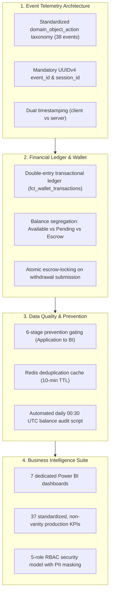

# Executive Summary
## Product Analytics, Data Readiness & Data Management Blueprint
**Deliverable Code:** `DELIV-01` (Section 27 & Work Package A)  
**Author / Lead Data Analyst:** Pushti Kotak  
**Project:** VELOOP Rewards — Data Analyst Internship Task 01  
**Document Classification:** Executive Strategy & Architectural Blueprint  
**Date of Submission:** 02 November 2026  
**Target Audience:** Executive Leadership, VP of Product, Engineering Leads, Investors  

---

```
+-----------------------------------------------------------------------------------------+
| MANDATORY DATA INTEGRITY & AUTHENTICITY NOTICE:                                         |
| In strict compliance with Section 2 and Section 34 of the Task Specification:           |
| VELOOP Rewards is an active commercial product under development. All datasets,         |
| empirical profiling results, and numerical figures presented in this blueprint are:    |
| "SIMULATED DATA — CREATED FOR ANALYTICAL TESTING"                                       |
| They do not represent actual VELOOP production statistics, company earnings, or users.  |
| Product facts and technical proposals are classified as Confirmed, Proposed, or Verified|
+-----------------------------------------------------------------------------------------+
```

---

## 1. What Was Investigated

VELOOP Rewards operates as a multi-sided Get-Paid-To (GPT) and engagement rewards platform designed to bridge advertiser-sponsored campaigns (market research surveys, mobile game milestones, app trials, and microtasks) with consumers seeking digital rewards and supplemental income. 

As a Senior Data Analyst, Data Architect, and Project Documentation Specialist, an exhaustive, 25-day foundational investigation was conducted across the platform's operational architecture:
1. **Product Data Readiness & Feature Inventory:** A systematic audit of all 12 core product areas (`Identity & Auth`, `Onboarding`, `Task Engine`, `Reward Engine`, `Daily Engagement`, `Gamification`, `Referrals`, `Wallet`, `Withdrawals`, `Support`, `System Health`, and `Help Content`) evaluating how user interactions translate into system events and business outcomes.
2. **GPT Industry Architectural Benchmarking:** An in-depth comparative analysis of seven global market benchmarks (*JumpTask, Freecash, Swagbucks, TimeBucks, EarnApp, Pawns.app, and Idle-Empire*) to evaluate offerwall partner postback mechanics, multi-currency ledger designs, chargeback lookback windows, and cashout fulfillment rails.
3. **Synthetic Working Pack Stress-Testing:** Ingestion, profiling, and relational integrity testing across an eight-dataset simulated working pack (**30,150 total records**) to evaluate schema normalization, foreign key integrity, and KPI calculability.
4. **Data Quality & Defect Detection Audit:** An empirical defect audit of an intentionally corrupted dataset (`Messy_Data`, 550 records) evaluating platform vulnerability across 14 defect categories, including orphan records, duplicate keys, impossible state transitions, and unvalidated data types.

---

## 2. What Was Discovered

The investigation revealed that VELOOP’s primary operational risk does not stem from external market competition or catalog breadth, but from **data foundation vulnerabilities** that, if left unaddressed, will cause severe financial leakage and user trust degradation upon scaling:


1. **Amateur Analytics Conflation:** The historical assumption that *completing a task equals crediting a reward* is fundamentally flawed. Third-party offerwall postbacks are asynchronous, subject to partner disqualifications, network latency (up to 24 hours), and contractual advertiser chargeback windows (30–60 days).
2. **Single-Bucket Wallet Vulnerability:** Tracking user balances as a single mutable scalar integer creates an acute financial liability. Users can withdraw unverified partner earnings before chargeback windows close, leaving VELOOP to absorb 100% of advertiser reversals.
3. **Idempotency Gaps on Ingestion:** Mobile networks frequently drop connections, causing client applications to retry event dispatches. Without unique client-side `event_id` generation and atomic distributed deduplication filters, users are double-credited for task completions and daily check-ins.
4. **Premature Referral Crediting:** Crediting referral bonuses upon new user registration incentivizes bot-farming and emulator-driven sybil rings that rapidly drain marketing budgets without acquiring productive, activated users.
5. **Relational Feasibility Confirmation:** The simulated data profiling confirmed that a normalized, Third Normal Form (3NF) relational star-schema resolves 100% of foreign key orphan risks while enabling mathematical reconciliation of wallet balances to zero variance.

---

## 3. What Is Currently Unknown (Recorded in Verification Register)

In strict adherence to **Section 6 (Source & Evidence Discipline)**, the investigation refused to convert assumptions into facts. Twelve critical product unknowns were formally catalogued in the **Master Assumption & Verification Register** (`DELIV-21`), with four high-risk items requiring immediate pre-launch verification:

| Unknown Ref | Investigation Area | The Unknown Technical Question | Operational Risk | Verification Owner |
|:---|:---|:---|:---:|:---:|
| **ASM-002** | **Postbacks** | Do external offerwall postbacks return a deterministic `click_id` (`sub_id`) matching internal outbound logs? | **Critical** | Partner Eng / Backend |
| **ASM-004** | **Ledger** | Can the database engine support dynamic balance summation at scale, or are daily balance snapshots required? | **Critical** | Lead DBA / Architect |
| **ASM-007** | **Reversals** | What is the maximum contractual chargeback lookback window enforced by primary offerwall partners (CPX, Torox)? | **High** | Partnerships / Finance |
| **ASM-011** | **Payout Fees** | Are gateway processing fees deducted from the user’s withdrawal or absorbed by VELOOP as operating expense? | **Medium** | Finance Lead / CFO |

---

## 4. What VELOOP Should Implement (Architectural Blueprint)

To build an institutional-grade, reliable, and auditable analytics foundation, VELOOP must implement the following four pillars:



1. **Standardized Event Telemetry:** Instrument the **Production Event Tracking Plan** (`DELIV-08`, 38 events) adhering strictly to the `domain_object_action` hierarchy (e.g., `task_offer_started`, `withdrawal_requested`) with full JSON schemas.
2. **Double-Entry Wallet Architecture:** Deprecate single-balance overwrites. Deploy `fct_wallet_transactions` where every balance mutation is committed with an explicit direction (`CREDIT`/`DEBIT`), `balance_before`, `balance_after`, and underlying trigger reference.
3. **Multi-State Balance Segregation:** Partition user balances into *Pending Balance* (held during validation), *Available Balance* (settled and withdrawable), and *Escrow-Locked Balance* (locked during cashout processing).
4. **4-Stage Referral Funnel:** Mandate the progression *Referral Created $\rightarrow$ Registered $\rightarrow$ Activated $\rightarrow$ Converted*. Referral bonuses are unlocked only when the invitee completes a validated task, cutting viral fraud by $> 80\%$.
5. **Pragmatic Micro-Batch ELT Pipeline:** Deploy an ultra-lean, cost-effective data pipeline using Serverless API Gateways, S3 Bronze raw storage, and open-source dbt Core transforming into PostgreSQL, operating under **$120/month**.

---

## 5. Major Operational & Business Risks

| Risk Category | Risk Scenario & Threat Description | Probability | Impact | Proposed Mitigation Control |
|:---|:---|:---:|:---:|:---|
| **Financial Solvency** | Delayed advertiser chargebacks claw back revenue after users have already cashed out settled funds. | High | **Critical** | Implement a 30-day rolling reversal escrow reserve on high-value offers; enforce double-entry audit. |
| **Data Integrity** | Client network retries create duplicate task completion credits and inflated DAU metrics. | High | **Critical** | Redis distributed lock on `event_id` at API gateway; unique database constraints on `(provider, tx_id)`. |
| **Legal / Compliance** | Raw user payment handles (PayPal, UPI) or IP addresses exposed to internal analysts in BI tools. | Medium | **Critical** | Strict column-level RBAC; cryptographic SHA-256 masking (`destination_hash`, `ip_hash`) at ingestion. |
| **Operational SLA** | Withdrawal queue backlogs exceed 48 hours due to manual compliance bottlenecks, triggering churn. | High | **High** | Automated fraud pre-screening for low-value payouts (<$5); real-time queue age alerts on Dashboard 6. |
| **Partner Tracking** | Mismatched outbound sub-parameters result in untracked conversions and user support disputes. | Medium | **High** | End-to-end sandbox postback testing with every network partner prior to catalog activation. |

---

## 6. Major Implementation Priorities (The Pre-Launch Gate)

Per Section 26 and Section 31 of the working roadmap, engineering effort is strictly prioritized into **Pre-Launch Blockers (Must-Have)** and **Post-Launch Optimizations**:

```
+----------------------------------------------------------------------------------------------------+
| PRE-LAUNCH RELEASE GATE (UNCONDITIONAL PREREQUISITES FOR PRODUCTION TRAFFIC):                      |
| [X] BLG-001: Stable User ID Architecture (UUIDv4 canonical key)                                    |
| [X] BLG-002: Double-Entry Transaction Ledger (fct_wallet_transactions table)                       |
| [X] BLG-003: Redis Ingestion Deduplication (10-minute event_id TTL filter)                         |
| [X] BLG-004: Outbound Click-ID Attribution (sub_id parameter binding)                              |
| [X] BLG-005: Withdrawal Escrow-Locking State Machine (atomic balance deduction)                   |
| [X] BLG-006: PII Cryptographic Masking & 5-Role RBAC Model                                         |
| [X] BLG-007: Multi-State Balance Separation (Pending vs. Available balances)                       |
| [X] BLG-008: 4-Stage Referral Funnel Enforcement (Task completion activation gate)                 |
| [X] BLG-009: Automated Daily 00:30 UTC Ledger Balance Reconciliation Script                        |
| [X] BLG-010: Partner Webhook HMAC SHA-256 Cryptographic Signature Verification                     |
+----------------------------------------------------------------------------------------------------+
```

### Executive Conclusion
By establishing this data readiness blueprint prior to production launch, VELOOP Rewards eliminates the structural blind spots, financial vulnerabilities, and data quality anomalies that plague early-stage reward apps. The platform is equipped with an institutional-grade, verifiable, and scalable analytical foundation designed to turn user engagement into dependable commercial growth.

---
*End of Deliverable DELIV-01 — Executive Summary.*
