# Product Data Readiness Audit Report
## VELOOP Rewards — Product Analytics, Data Readiness & Data Management Blueprint
**Deliverable Code:** `DELIV-02` (Work Package A)  
**Author / Analyst:** Pushti Kotak  
**Document Classification:** Internal Technical Architecture / Data Audit  
**Date:** 02 November 2026  
**Status:** Complete & Verified  

---

## 1. Executive Overview & Audit Objective

The objective of the **Product Data Readiness Audit** is to conduct a systematic, end-to-end investigation of the VELOOP Rewards ecosystem to determine what data the platform must capture across every product module, user touchpoint, and backend workflow. 

As a developing Get-Paid-To (GPT) platform, VELOOP operates as a multi-sided marketplace linking advertisers, microtask networks, gamified reward loops, and cashout infrastructure. Without an intentional, rigorous data foundation established prior to production scaling, the platform faces acute operational risks, including:
* Inability to reconcile user claims against advertiser postbacks (causing reward disputes).
* Vulnerability to duplicate crediting and multi-accounting fraud.
* Unmonitored financial leakage between gross partner receivables and net user withdrawal liabilities.
* Black-box user funnels with blind spots in onboarding drop-offs and feature abandonment.

This audit establishes:
1. **A complete structural mapping** of all 12 core VELOOP product areas.
2. **Granular user action flows** and behavioral state transitions.
3. **Rigorous separation** of User Events, System Events, and Business Outcomes.
4. **An analysis of 12 critical analytics gaps** that threaten production reporting and operational trust.

---

## 2. Structural Separation: User Events vs. System Events vs. Business Outcomes

A primary failure mode in amateur analytics instrumentation is confounding **what a user did** with **how the system responded** and **the financial result**. VELOOP enforces a strict three-tier classification:

```mermaid
flowchart LR
    subgraph Tier1["1. User Event (Client/Server Trigger)"]
        U1["User clicks 'Claim Reward'"]
        U2["User submits withdrawal form"]
        U3["User taps 'Start Survey'"]
    end

    subgraph Tier2["2. System Event (Backend Validation/Webhook)"]
        S1["Partner postback verified"]
        S2["Wallet debit ledger entry generated"]
        S3["Fraud risk score computed"]
    end

    subgraph Tier3["3. Business Outcome (Financial/Operational Impact)"]
        B1["Reward liability recognized"]
        B2["Net revenue generated"]
        B3["User activated / Retained"]
    end

    Tier1 --> Tier2 --> Tier3
```



* **User Events (Behavioral Signal):** Emitted directly when a user interacts with a client interface element (e.g., `task_opened`, `withdrawal_requested`, `referral_code_shared`). These measure user intent, engagement latency, and friction points.
* **System Events (State & Operational Engine):** Emitted asynchronously by backend services, scheduled cron workers, or external partner postbacks (e.g., `postback_received`, `reward_credited`, `withdrawal_reviewed`, `account_suspended`). These measure operational reliability, processing throughput, and fraud defenses.
* **Business Outcomes (Financial & Growth State):** Derived milestones that impact platform unit economics, compliance, and user retention (e.g., `gross_margin_realized`, `referral_converted`, `reward_liability_accrued`).

---

## 3. Product Area Mapping & Functional Inventory

The table below outlines the core product areas of VELOOP Rewards, cataloguing the features, observable user actions, resulting system outcomes, essential analytical data requirements, core business questions, and verification status.

| Product Area | Feature / Module | Observable User Action | System Outcome | Data Required | Core Business Question | Status |
|:---|:---|:---|:---|:---|:---|:---|
| **01. Identity & Auth** | Registration | Enters credentials, accepts terms, submits | User account created, initial balance initialized, welcome notification sent | `user_id`, `auth_provider`, `country_code`, `device_type`, `ip_hash`, `timestamp`, `referral_code` | What channels yield users with the lowest 30-day churn? | **Confirmed** |
| **01. Identity & Auth** | Login & Session | Submits login credentials | Session token issued, session timer started, last login timestamp updated | `user_id`, `session_id`, `login_method`, `app_version`, `os_version`, `timestamp` | What is our true Daily Active User (DAU) count by platform? | **Confirmed** |
| **02. Onboarding** | Welcome Tutorial | Swipes tutorial slides, clicks 'Get Started' | Onboarding flag marked completed, onboarding bonus unlocked | `user_id`, `step_index`, `duration_seconds`, `completed_flag`, `timestamp` | Where do new users drop off during initial product setup? | **Proposed** |
| **03. Task Engine** | Offerwall Browsing | Scrolls task feed, filters by category (Surveys/Games) | Query logged, impression counters updated | `user_id`, `category_selected`, `provider_id`, `filter_applied`, `offers_viewed_count` | Which task categories generate the highest browse-to-click conversion? | **Confirmed** |
| **03. Task Engine** | Task Execution | Clicks 'Start Task', redirects to external provider | Redirect URL signed with tracking sub-ID, task state set to `Started` | `task_id`, `user_id`, `provider_id`, `click_id`, `reward_amount`, `reward_unit`, `timestamp` | What percentage of initiated tasks reach external completion? | **Confirmed** |
| **03. Task Engine** | Task Completion & Postback | Completes survey or game milestone externally | Partner webhook received, verified, task marked `Completed` | `click_id`, `postback_id`, `partner_status`, `payout_received_usd`, `timestamp` | What is our postback discrepancy and dropped-tracking rate by provider? | **Confirmed** |
| **04. Reward Engine** | Balance Crediting | Views credit confirmation modal | Ledger credit posted to user balance, push notification dispatched | `reward_id`, `user_id`, `task_id`, `credit_amount`, `currency_unit`, `status`, `timestamp` | What is the total accrued user reward liability this calendar month? | **Confirmed** |
| **04. Reward Engine** | Reward Reversal | Submits dispute or partner triggers chargeback | Reversal ledger entry posted, balance adjusted or frozen | `reversal_id`, `original_reward_id`, `reason_category`, `partner_id`, `deduction_amount` | What is our fraud chargeback rate per external offerwall network? | **Confirmed** |
| **05. Daily Engagement**| Daily Check-in / Streak | Taps 'Claim Daily Bonus' | Streak counter incremented (+1), progressive bonus awarded | `user_id`, `streak_count`, `bonus_amount`, `bonus_type`, `is_perfect_week`, `timestamp` | Do 7-day streak users exhibit higher task completion frequencies? | **Confirmed** |
| **05. Daily Engagement**| Daily Spin Wheel | Taps 'Spin', watches animation | RNG result computed server-side, prize credited, cooldown timer set | `user_id`, `spin_id`, `prize_type`, `prize_amount`, `spins_remaining`, `timestamp` | What is the expected virtual cost per active user spin? | **Confirmed** |
| **06. Gamification** | Missions & Quests | Clicks 'Claim Quest Reward' upon milestone reach | Quest marked completed, XP/Gem reward credited, badge unlocked | `user_id`, `quest_id`, `milestone_metric`, `reward_xp`, `reward_gems`, `timestamp` | Which gamified quests accelerate second-day retention? | **Proposed** |
| **06. Gamification** | Badges & Levels | Views profile progression bar | User level recalculated, level-up perk unlocked | `user_id`, `current_level`, `total_xp`, `badge_id`, `unlock_timestamp` | Does leveling up correlate with higher lifetime task yield? | **Proposed** |
| **07. Referral System** | Link Generation & Sharing | Clicks 'Share Referral Link', copies code | Referral record generated with attribution tracking token | `referral_id`, `referrer_user_id`, `share_channel`, `timestamp` | Which social channels drive the highest referral link shares? | **Confirmed** |
| **07. Referral System** | Referral Conversion | Referred user registers and completes qualifying task | Referral bonus credited to referrer, referral status set to `Converted` | `referral_id`, `referred_user_id`, `trigger_task_id`, `bonus_amount`, `conversion_timestamp` | What is our true referral conversion rate (Created $\rightarrow$ Converted)? | **Confirmed** |
| **08. Wallet & Balance**| Balance Inspection | Opens wallet tab, toggles Pending vs. Withdrawable | Read-only ledger summary fetched and rendered | `user_id`, `pending_balance`, `available_balance`, `lifetime_earned`, `timestamp` | How frequently do users monitor pending rewards prior to cashout? | **Confirmed** |
| **09. Withdrawals** | Payout Request | Selects method (PayPal/Crypto/Gift Card), submits amount | Payout request queued, balance locked in escrow, compliance check | `withdrawal_id`, `user_id`, `payout_method`, `requested_amount`, `fee_amount`, `status`, `timestamp` | What is the average time from registration to first payout request? | **Confirmed** |
| **09. Withdrawals** | Payout Fulfillment | None (System/Payment gateway action) | Gateway API response received, status set to `Completed`, user notified | `withdrawal_id`, `gateway_tx_id`, `processing_duration_sec`, `settlement_status` | What is our payment gateway failure rate and mean processing duration? | **Confirmed** |
| **10. Support & Trust** | Missing Credit Ticket | Fills missing credit ticket with screenshot proof | Ticket created, routing to offerwall partner or internal review | `ticket_id`, `user_id`, `task_id`, `partner_id`, `dispute_reason`, `status`, `timestamp` | Which offerwall partners generate the highest missing credit ticket volume? | **Confirmed** |
| **11. System Health** | Error & Timeout Telemetry | Experiences crash or API error | Sentry/crash log emitted, client telemetry recorded | `error_id`, `user_id`, `endpoint`, `http_status`, `device_model`, `stack_trace_hash` | Are specific Android OS builds failing during external offer redirects? | **Proposed** |
| **12. Content & Help** | FAQ / Guide Reading | Clicks FAQ article on withdrawal minimums | Article impression logged, search term indexed | `user_id`, `article_id`, `read_time_seconds`, `was_helpful_flag`, `timestamp` | Does reading payout rules before cashout reduce support disputes? | **Proposed** |

---

## 4. Granular User Action Hierarchies

To ensure developers instrument events at the exact logical moment of user interaction, we map the step-by-step state hierarchies for VELOOP's three core operational lifecycles:

### A. The Earning & Task Lifecycle
```
[1. Task Browsed] 
       ↓ (Category/Offer Selection)
[2. Task Opened / Details Viewed]
       ↓ (Eligibility Verified, Click URL Generated)
[3. Task Started] (Redirect to Third-Party Provider)
       ↓ (External User Execution: App Install / Survey Fill / Game Play)
[4. Task Submitted / Completed Externally]
       ↓ (Server-to-Server Postback Callback Received)
[5. Task Completion Validated]
       ↓ (Business Rules Evaluated: Deduplication, Fraud Score)
[6. Reward Credited to Pending Ledger]
       ↓ (Reversal Lookback Window Cleared)
[7. Reward Released to Withdrawable Balance]
```

### B. The Wallet & Withdrawal Lifecycle
```
[1. User Reaches Minimum Payout Threshold]
       ↓ (Selects Payout Method & Enters Destination Account)
[2. Withdrawal Form Submitted] (`withdrawal_requested`)
       ↓ (Funds Escrowed: Balance Locked to Prevent Double-Spend)
[3. Automated Fraud / Compliance Pre-Screening]
       ├── [Passed]  → Status = `Under Review / Processing`
       └── [Flagged] → Status = `Manual Review Queued`
       ↓ (Payment Gateway Batch Dispatch)
[4. Payment Gateway Final Settlement]
       ├── [Success]  → Status = `Completed` (`withdrawal_completed`)
       ├── [Declined] → Status = `Rejected` (Funds Returned to Wallet)
       └── [Disputed] → Status = `Reversed` (Ledger Debit Correction)
```

### C. The Referral Attribution Funnel
```
[1. Referrer Generates Referral Link / Code] (`referral_created`)
       ↓ (Link Shared via Social / Messaging / Direct)
[2. Invitee Visits Landing Page] (`referral_link_clicked`)
       ↓ (Invitee Completes Account Creation with Referral Token)
[3. Invitee Registers Account] (`referral_registered`)
       ↓ (Invitee Completes First Validated Task / Minimum Earning Milestone)
[4. Invitee Activates] (`referral_activated`)
       ↓ (Attribution Lock; Referrer Reward Credited)
[5. Referral Converts] (`referral_converted`)
```

---

## 5. Identification of 12 Critical Analytics Gaps

Per Section 7 (A4) of the Task Specification, the audit must explicitly identify at least 10 critical analytics gaps that would compromise production reporting, financial integrity, or engineering troubleshooting if left unaddressed.

| Gap ID | Area | Critical Analytics Gap Description | Root Cause / Technical Vulnerability | Business & Operational Impact | Recommended Architectural Solution |
|:---|:---|:---|:---|:---|:---|
| **GAP-01** | **Identity** | **No Session Tracking Identifier** | Client currently lacks a deterministic `session_id` passed in event payloads. | Cannot calculate bounce rates, task engagement duration, or multi-tab collision behavior. | Inject client-side UUIDv4 `session_id` regenerated after 30 minutes of app inactivity. |
| **GAP-02** | **Tracking** | **Postback Attribution Disconnect** | External offerwall clicks do not store an internal `click_id` linked to the user session. | When a partner postback arrives or fails, support cannot prove whether the user actually initiated the task. | Store an immutable `outbound_click` record with unique `click_id` passed as `sub_id` to partner networks. |
| **GAP-03** | **Wallet** | **Single-Bucket Balance (No Pending vs. Settled Distinction)** | User balance modeled as a single scalar integer without state segregation. | Users attempt to withdraw unverified partner earnings, causing severe financial chargeback liability. | Implement multi-ledger balance: `pending_balance`, `available_balance`, and `escrow_locked_balance`. |
| **GAP-04** | **Ingestion** | **No Idempotency / Deduplication Keys on Ingestion** | Ingestion endpoints accept events without checking unique payload tokens. | Unstable mobile network retries duplicate task completions, daily check-ins, and reward payouts. | Mandate client-side `event_id` and enforce unique database constraint on `(event_name, user_id, idempotency_key)`. |
| **GAP-05** | **Growth** | **Premature Referral Crediting (Registration = Conversion)** | System rewards referrers immediately upon new user registration. | Highly vulnerable to bot-registration rings that drain referral pools without generating active users. | Enforce strict 4-stage funnel: credit referral rewards only upon reaching `referral_activated` state. |
| **GAP-06** | **Payouts** | **Lack of Payout Escrow & Transaction State Machine** | Balance is deducted only *after* payment gateway confirms completion. | Race condition allows users to submit multiple concurrent withdrawal requests exceeding their actual balance. | Lock withdrawal amount in `escrow_locked` status at the millisecond of request submission. |
| **GAP-07** | **Data Quality** | **Unstandardized Currency Units & Exchange Rates** | Rewards and tasks record raw amounts without explicit unit tags (`VE`, `XP`, `GEMS`, `USD`). | Erroneous aggregation of incompatible virtual currencies, invalidating revenue and KPI reporting. | Enforce composite currency representation: mandatory `amount` (numeric) paired with `unit` (enum). |
| **GAP-08** | **Engineering**| **Inconsistent Client vs. Server Event Timestamps** | Events logged with client device clock time without server receipt timestamp. | Users manipulating device clocks bypass cooldowns and corrupt cohort retention analysis. | Record dual timestamps for every event: `client_timestamp` (local) and `server_received_timestamp` (UTC). |
| **GAP-09** | **Governance** | **Raw PII Exposure in Analytical Reporting Tables** | User emails and payment handles stored in the same tables accessed by analytical BI tools. | Major GDPR / DPDP compliance violation; exposes sensitive user data to unauthorized internal roles. | Establish strict column-level RBAC and pseudonymized user dimension (`user_pseudo_id`) for analytics. |
| **GAP-10** | **Monitoring** | **Zero Automated Partner Reconciliation Monitoring** | No automated reconciliation script comparing partner billing reports with internal credit records. | Undetected partner postback drops go unnoticed for weeks, resulting in uncollected platform revenue. | Implement daily automated reconciliation jobs flagging discrepancies $> 2\%$ between partner and internal logs. |
| **GAP-11** | **Fraud** | **Missing Device Fingerprint & Geo-IP Consistency Checks** | Analytics does not capture hashed device identifiers or proxy/VPN flags during cashout. | Payout fraud networks cash out from stolen accounts using rotating residential proxies undetected. | Enrich login and withdrawal events with `ip_hash`, `is_vpn_flag`, and `device_fingerprint_hash`. |
| **GAP-12** | **Lifecycle** | **No Formal Inactivity / Account Churn Definition** | System lacks a scheduled job that updates user account status based on activity recency. | Inflated active user metrics that skew retention curves and distort investor reporting. | Implement automated daily cron transitioning users to `Dormant` (14d inactive) and `Churned` (30d inactive). |

---

## 6. Audit Conclusion & Handoff to Data Modeling

This Product Data Readiness Audit confirms that VELOOP’s operational data requirements cannot be supported by an ad-hoc or flat-table schema. The platform requires:
1. A **normalized, double-entry transactional model** for all balance mutations.
2. A **unified event taxonomy** utilizing a standardized `domain_object_action` naming convention.
3. Explicit **state-machine tracking** across Task Execution, Referral Attribution, and Withdrawal Fulfillment.

The detailed, row-level mapping of these requirements is formalized in the companion **Data Coverage Matrix** (`DELIV-03`), which establishes the exact field-level instrumentation required for developer implementation.

---
*End of Deliverable DELIV-02 — Product Data Readiness Audit Report.*
