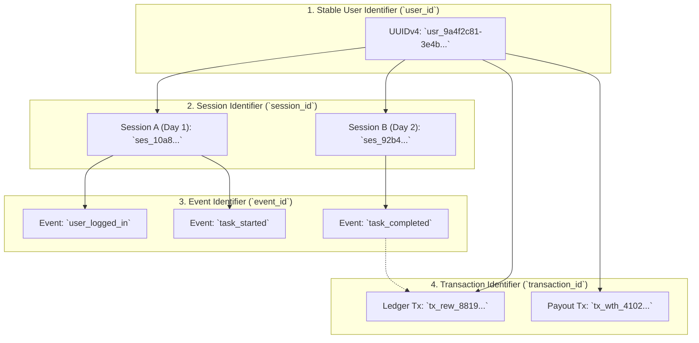
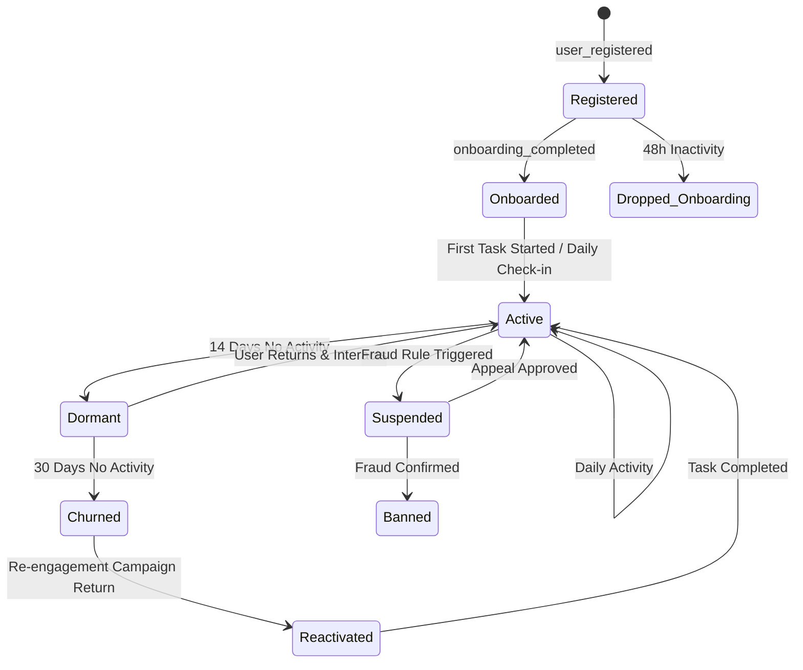

# User & Account Analytics Specification
## VELOOP Rewards — Product Analytics, Data Readiness & Data Management Blueprint
**Deliverable Code:** `DELIV-04` (Work Package B)  
**Author / Analyst:** Pushti Kotak  
**Document Classification:** Internal Technical Architecture / Specification  
**Date:** 02 November 2026  
**Status:** Complete & Verified  

---

## 1. Objective & Scope

The **User & Account Analytics Specification** defines the foundational identity and behavioral structure required to track, model, and analyze the user lifecycle within VELOOP Rewards. 

In a rewards ecosystem, user identity serves as the backbone of attribution, fraud prevention, transaction integrity, and cohort retention. Tracking identity across fragmented touchpoints—such as mobile web, native Android/iOS clients, and external third-party offerwalls—demands a multi-tiered identifier architecture that preserves analytical continuity while strictly upholding privacy-by-design standards (Section 8 & Section 34).

This document formalizes:
1. **The Four Essential Identifiers** (Stable User ID, Event ID, Session ID, Transaction ID).
2. **The User Lifecycle State Machine** (Registration $\rightarrow$ Onboarding $\rightarrow$ Activation $\rightarrow$ Retention $\rightarrow$ Dormancy $\rightarrow$ Churn).
3. **The User Analytics Schema Specification** detailing all user entity attributes, data types, validation rules, and privacy classifications.

---

## 2. B1. User Identity Architecture & Identifier Taxonomy

Tracking user behavior across client sessions, distributed microservices, and external partner networks requires four distinct, non-overlapping identifiers. Each satisfies a specific analytical and architectural need:

### 1. Stable User Identifier (`user_id`)
* **Technical Definition:** A canonical, immutable 128-bit Universally Unique Identifier (UUIDv4), formatted with a domain prefix (e.g., `usr_4f9a12c8-88be-4011-8e9a-251a37c93e41`).
* **Why It Is Needed:** 
  * Provides a permanent analytical anchor for cross-session cohort tracking, lifetime value (LTV) calculation, and longitudinal retention analysis.
  * Remains completely decoupled from mutable personal details (e.g., email address, phone number, username) to support privacy compliance (GDPR/DPDP "Right to Erasure") and account updates without breaking foreign key relationships.

### 2. Session Identifier (`session_id`)
* **Technical Definition:** An ephemeral, time-bounded UUID generated client-side upon app initialization or user login, renewing automatically after 30 minutes of continuous inactivity (e.g., `ses_8820c41b-41a2-4d22-b5e1-88931a029c11`).
* **Why It Is Needed:**
  * Enables session-level aggregation: bounce rate calculation, pages/screens viewed per visit, session duration, and task conversion within a single continuous user engagement window.
  * Prevents session skew caused by mobile backgrounding, where an app remains resident in memory for days without active user interaction.

### 3. Event Identifier (`event_id`)
* **Technical Definition:** A unique, non-fungible UUID generated at the precise millisecond and client thread where an event is triggered (e.g., `evt_118c72fa-7740-4592-80ea-12003c0048ab`).
* **Why It Is Needed:**
  * **Idempotency & Deduplication:** When mobile clients encounter intermittent cellular connectivity, event queues retry transmission. The backend event collector uses `event_id` to enforce a strict deduplication window, discarding duplicate payloads and preventing double-counting of user actions.
  * Provides end-to-end event lineage and debugging traces across distributed asynchronous pipelines.

### 4. Transaction Identifier (`transaction_id`)
* **Technical Definition:** A cryptographically unique, server-generated sequence identifier assigned to every atomic financial balance mutation (e.g., `tx_901c8742-8812-40ae-bf31-55198ad00142`).
* **Why It Is Needed:**
  * Enforces double-entry ledger bookkeeping. Every credit or debit must map to exactly one immutable transaction row.
  * Provides a deterministic audit trail for reconciling external partner chargebacks, user disputes, missing credit tickets, and payment gateway settlement batches.

---

## 3. Account Lifecycle State Machine

Users progress through a formal state machine that governs access privileges, earning eligibility, fraud monitoring, and analytical categorization:

* **Registered:** Account created and credentials hashed; email verification pending or unverified.
* **Onboarded:** Welcome tutorial completed or skipped; user has viewed the main task feed.
* **Active:** User has performed at least one qualified action (task started, daily check-in, spin) within the trailing 7 days.
* **Dormant:** No activity recorded for $14 \le \text{days} < 30$.
* **Churned:** No activity recorded for $\ge 30$ consecutive days.
* **Suspended:** Account temporarily locked due to multi-accounting flags, emulator detection, or proxy/VPN triggers.
* **Banned:** Permanently restricted following confirmed fraud audit; balances forfeited.

---

## 4. B2. User Analytics Schema Specification

The schema below details the core analytical attributes modeled for the user dimension. In compliance with **Section 8 (B2)**, no unnecessary personal information (e.g., raw passwords, street addresses, national identity numbers, payment card numbers) is collected or exposed.

| Field Name | Physical Data Type | Required? | Analytical Purpose | Ingestion Source | Validation Rule / Allowed Values | Privacy Sensitivity | Status |
|:---|:---|:---|:---|:---|:---|:---|:---|
| `user_id` | `VARCHAR(36)` (UUID) | **Yes** | Primary canonical user key across all tables. | Backend Auth Service | Valid UUIDv4 format (`usr_[0-9a-f-]{36}`) | Internal | **Confirmed** |
| `account_status` | `VARCHAR(20)` | **Yes** | Governs platform access and user lifecycle cohorting. | Backend State Engine | `Registered`, `Onboarded`, `Active`, `Dormant`, `Churned`, `Suspended`, `Banned` | Internal | **Confirmed** |
| `registration_timestamp`| `TIMESTAMP WITH TIME ZONE` | **Yes** | Tracks exact user creation moment; cohort anchor. | Backend Database | UTC format; $\le \text{CURRENT\_TIMESTAMP}$ | Internal | **Confirmed** |
| `registration_source` | `VARCHAR(50)` | **Yes** | Measures organic vs. paid marketing acquisition channels. | Client Referrer / URL | `Organic_Search`, `Direct`, `Google_Ads`, `Meta_Ads`, `Referral_Program`, `Influencer` | Internal | **Confirmed** |
| `referral_code_used` | `VARCHAR(20)` | No | Attributions new registration to a referrer user. | Registration Form | Alphanumeric string; 6–12 characters or `NULL` | Internal | **Confirmed** |
| `auth_provider` | `VARCHAR(20)` | **Yes** | Measures adoption of OAuth vs. native email credentials. | Auth Gateway | `Email_Password`, `Google_OAuth`, `Apple_ID`, `Telegram` | Internal | **Confirmed** |
| `country_code` | `CHAR(2)` | **Yes** | Enables geographic segmentation and offer availability. | Geo-IP Ingestion Filter | ISO 3166-1 alpha-2 uppercase string (`IN`, `US`, `GB`, `BR`, etc.) | Internal | **Confirmed** |
| `signup_device_type` | `VARCHAR(20)` | **Yes** | Device categorization for technical QA and UI tuning. | User-Agent Parser | `Android_Mobile`, `iOS_Mobile`, `Desktop_Web`, `Mobile_Web` | Internal | **Confirmed** |
| `signup_app_version` | `VARCHAR(15)` | No | Tracks software release version at initial registration. | Client Headers | Semantic version string (`v1.0.0`, `v1.2.4`) | Internal | **Confirmed** |
| `signup_ip_hash` | `VARCHAR(64)` | **Yes** | Detects mass bot registrations from identical IP subnets. | Ingestion Pipeline | SHA-256 hashed IP string; raw IP discarded | Restricted | **Proposed** |
| `email_verified_flag` | `BOOLEAN` | **Yes** | Distinguishes verified accounts from disposable addresses. | Auth Database | `TRUE` or `FALSE`; defaults to `FALSE` | Internal | **Confirmed** |
| `onboarding_completed_flag`| `BOOLEAN` | **Yes** | Identifies whether user completed initial tutorial. | Frontend Milestone | `TRUE` or `FALSE`; defaults to `FALSE` | Internal | **Confirmed** |
| `onboarding_completed_at` | `TIMESTAMP WITH TIME ZONE` | No | Computes registration-to-onboarding completion latency. | Frontend Event Worker | UTC timestamp; $\ge \text{registration\_timestamp}$ | Internal | **Proposed** |
| `current_level` | `INTEGER` | **Yes** | Tracks user gamification tier and leveling status. | Gamification Worker | Integer $\ge 1$; defaults to `1` | Internal | **Confirmed** |
| `total_xp` | `INTEGER` | **Yes** | Cumulative experience points earned across platform. | Reward Engine | Integer $\ge 0$; monotonically increasing | Internal | **Confirmed** |
| `current_streak_days` | `INTEGER` | **Yes** | Tracks active daily check-in streak length. | Engagement Service | Integer $\ge 0$; resets to `0` upon missed check-in | Internal | **Confirmed** |
| `lifetime_ve_earned` | `DECIMAL(12, 2)` | **Yes** | Historical sum of all VELOOP Earnings credited. | Wallet Service | Numeric $\ge 0.00$; scale 2 | Internal | **Confirmed** |
| `lifetime_usd_withdrawn`| `DECIMAL(10, 2)` | **Yes** | Historical sum of all successfully settled payouts. | Withdrawal Service | Numeric $\ge 0.00$; scale 2 | Internal | **Confirmed** |
| `last_active_timestamp` | `TIMESTAMP WITH TIME ZONE` | **Yes** | Evaluates dormancy, churn, and active user metrics. | Event Stream Trigger | UTC timestamp; $\ge \text{registration\_timestamp}$ | Internal | **Confirmed** |
| `last_login_device` | `VARCHAR(50)` | No | Monitors account switching and multi-device usage. | Login Event Payload | Hardware model string (e.g., `Samsung SM-G991B`) | Internal | **Proposed** |

---

## 5. Security, Pseudonymization & Compliance Alignment

1. **Elimination of PII in Analytics:** Analytical models and BI reports must query an anonymized view (`v_dim_users_anonymized`) where `email_hash` and `signup_ip_hash` are excluded.
2. **Right to Erasure (GDPR / DPDP Compliance):** When a user requests account deletion:
   * The user’s personal credentials in the core Auth DB are purged.
   * Analytical transaction logs retain the synthetic `user_id` with `account_status = 'Deleted'` to ensure financial ledger balance reconciliations remain mathematically balanced without holding personal identifiers.
3. **No Credential Ingestion:** Passwords, password reset tokens, and third-party OAuth access tokens are blocked at the API gateway layer and strictly excluded from analytics pipelines.

---
*End of Deliverable DELIV-04 — User & Account Analytics Specification.*
