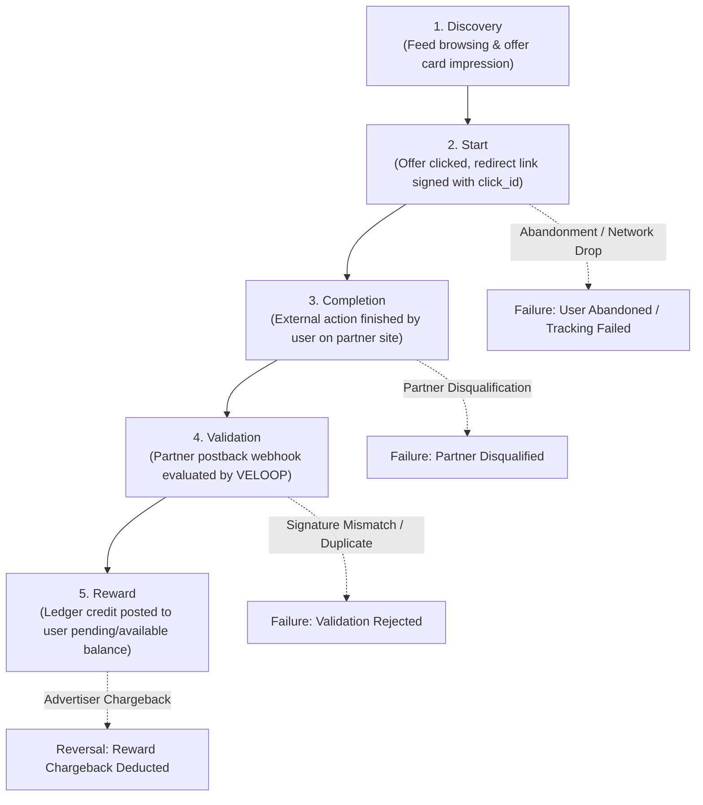
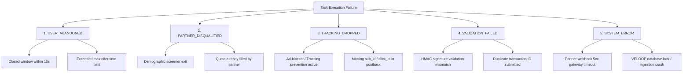
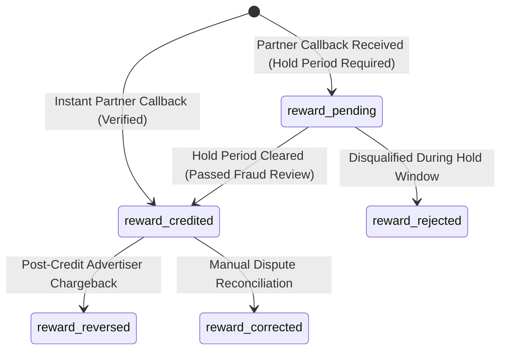

# Earning & Reward Analytics Specification
## VELOOP Rewards — Product Analytics, Data Readiness & Data Management Blueprint
**Deliverable Code:** `DELIV-05` (Work Package C)  
**Author / Analyst:** Pushti Kotak  
**Document Classification:** Internal Technical Architecture / Specification  
**Date:** 02 November 2026  
**Status:** Complete & Verified  

---

## 1. Objective & Architectural Scope

The **Earning & Reward Analytics Specification** establishes the analytical foundation for measuring all revenue-generating and incentive-distributing activities on VELOOP Rewards. 

As a Get-Paid-To (GPT) platform, VELOOP’s business engine relies on a multi-stage funnel where users discover third-party campaigns (surveys, game installs, product trials, microtasks), execute them outside VELOOP's immediate application boundary, and await asynchronous advertiser verification before rewards can be credited. 

Amateur analytics implementations often make the fatal assumption that *task completion equals reward delivery*. This specification enforces:
1. **The 5-Stage Analytical Lifecycle** (*Discovery $\rightarrow$ Start $\rightarrow$ Completion $\rightarrow$ Validation $\rightarrow$ Reward*).
2. **Strict Disentanglement** of user actions from asynchronous reward crediting.
3. **A Structured Taxonomy for Failed Activities & Tracking Drops**.
4. **Resilient Handling of Third-Party Dependencies, Postbacks, and Chargebacks**.

---

## 2. The 5-Stage Earning Analytical Lifecycle

Every earning interaction must be evaluated as an asynchronous sequence across five distinct state boundaries:

1. **Discovery (Client Trigger):** The user scrolls the offerwall feed and views an available earning opportunity. Analyzed via impressions, click-through rates (CTR), and category sorting.
2. **Start (Client & Server Handshake):** The user clicks "Start Task". VELOOP records a `task_started` event, generates an immutable `click_id`, appends tracking sub-parameters (`sub_id={user_id}&sub_id2={task_id}`), and executes the external redirect.
3. **Completion (External Boundary):** The user completes the survey, reaches an in-game milestone, or installs an app on an external ecosystem. This step is completely outside VELOOP’s direct runtime environment.
4. **Validation (Server-to-Server Ingestion):** The third-party offerwall network dispatches a server-to-server HTTP postback webhook. VELOOP verifies HMAC signatures, checks for duplicate transaction IDs, and validates that the user exists and is active.
5. **Reward (Financial Ledger Execution):** Upon successful validation, the reward engine writes an immutable credit transaction to the user's wallet ledger (`reward_credited`).

---

## 3. C1. Task-Level Analytics Specification

The schema below details the analytical entity for tracking individual task interactions (`dim_tasks` and `fct_task_activity`):

| Attribute Name | Data Type | Required? | Description & Analytical Purpose | Ingestion Source | Validation / Constraints | Status |
|:---|:---|:---|:---|:---|:---|:---|
| `task_activity_id` | `VARCHAR(36)` | **Yes** | Primary key for this specific task execution attempt. | Backend API | UUIDv4 format (`tact_[0-9a-f-]{36}`) | **Confirmed** |
| `task_id` | `VARCHAR(32)` | **Yes** | Foreign key identifying the specific campaign/offer. | Task Catalog Service | Pre-registered campaign identifier | **Confirmed** |
| `task_name` | `VARCHAR(100)`| **Yes** | Human-readable name of the offer (e.g., 'Board Kings Level 15').| Catalog Metadata | Non-empty string | **Confirmed** |
| `task_type` | `VARCHAR(30)` | **Yes** | Categorization for portfolio performance and yield analysis. | Task Catalog Service | `Survey`, `Game_Install`, `App_Trial`, `Microtask`, `Ad_Video`, `Purchase_Cashback` | **Confirmed** |
| `provider_id` | `VARCHAR(30)` | **Yes** | External partner providing the campaign. | Partner Gateway | `CPX_Research`, `Torox`, `AdGate`, `BitLabs`, `Lootably`, `RevU`, `Internal` | **Confirmed** |
| `user_id` | `VARCHAR(36)` | **Yes** | Foreign key linking activity to stable user identity. | Client Session / Token | Valid UUIDv4 in `dim_users` | **Confirmed** |
| `click_id` | `VARCHAR(64)` | **Yes** | Outbound tracking token passed to partner network. | Click Router | Cryptographic token matching outbound redirect log | **Confirmed** |
| `start_time` | `TIMESTAMP` | **Yes** | Precise moment user initiated the task redirect. | Ingestion Gateway | UTC timestamp; $\le \text{CURRENT\_TIMESTAMP}$ | **Confirmed** |
| `completion_time`| `TIMESTAMP` | No | Timestamp when external partner postback was received. | Partner Postback | UTC timestamp; $\ge \text{start\_time}$ or `NULL` | **Confirmed** |
| `activity_status`| `VARCHAR(20)` | **Yes** | Current lifecycle status of the task attempt. | Backend State Engine | `Started`, `Completed`, `Failed`, `Abandoned`, `Disqualified` | **Confirmed** |
| `reward_amount` | `DECIMAL(10,2)`| **Yes** | Amount of virtual currency promised/credited to user. | Task Catalog / Partner | Numeric $\ge 0.00$; defaults to offer listed value | **Confirmed** |
| `reward_unit` | `VARCHAR(10)` | **Yes** | Virtual currency unit assigned to the task. | Task Catalog | `VE`, `XP`, `GEMS`, `TOKENS` | **Confirmed** |
| `validation_status`| `VARCHAR(20)`| **Yes** | Verification state of partner-submitted postback. | Reward Engine | `Pending_Validation`, `Validated_Approved`, `Validation_Rejected`, `Unverified` | **Confirmed** |
| `estimated_payout_usd`| `DECIMAL(8,4)`| **Yes** | Gross commercial revenue expected from partner per lead. | Contract Rate Card | Numeric $> 0.0000$ (e.g., \$1.2500) | **Proposed** |
| `user_reward_share_pct`| `DECIMAL(4,2)`| **Yes** | Contractual share of payout allocated to user. | Business Logic Engine | Numeric between `0.40` and `0.85` (default `0.65`) | **Proposed** |

---

## 4. C2. Structured Taxonomy for Failed Activities

When an earning activity fails, recording a generic "Error" status obscures actionable product insights. In compliance with **Section 9 (C2)**, the following structured classification taxonomy is established (`Status: Proposed`):

### Detailed Failure Code Register (`Status: Proposed`)

| Category Code | Sub-Reason Code | Diagnostic Description | Responsible Layer | Analytical Metric Impact |
|:---|:---|:---|:---|:---|
| `USER_ABANDONED` | `TIMEOUT_EXPIRED` | User started task but no postback was received within 72 hours. | User Behavior | Reduces Start-to-Complete Conversion. |
| `USER_ABANDONED` | `IMMEDIATE_EXIT` | User closed offer tab within $<15$ seconds of redirect. | UX / Offer Fit | Highlights misleading offer terms or slow loading. |
| `PARTNER_DISQUALIFIED` | `DEMO_SCREENOUT` | User screened out during survey demographic pre-qualification. | Partner Targeting | Identifies mismatched survey targeting rules. |
| `PARTNER_DISQUALIFIED` | `QUOTA_FULL` | Partner capped total completions before user submitted survey. | Partner Management | Flags unoptimized offer inventory. |
| `TRACKING_DROPPED` | `ADBLOCK_DETECTED` | Client ad-blocker or Safari ITP blocked attribution redirect. | Client Environment | Drives user education on tracking permissions. |
| `TRACKING_DROPPED` | `SUBID_LOST` | Partner postback returned without internal `click_id` payload. | Partner Integration | Flags partner SDK bug; requires engineering ticket. |
| `VALIDATION_FAILED` | `SIGNATURE_MISMATCH` | Webhook security token or MD5/SHA256 signature was invalid. | Security / Fraud | Blocks unauthorized or forged partner postbacks. |
| `VALIDATION_FAILED` | `DUPLICATE_TX_ID` | Partner attempted to postback the same `external_tx_id` twice. | Ingestion Pipeline | Enforces idempotency; prevents double crediting. |
| `SYSTEM_ERROR` | `INGESTION_TIMEOUT` | Internal webhook endpoint returned 504 Gateway Timeout. | Infrastructure | Monitored by DevOps; triggers automated retries. |
| `SYSTEM_ERROR` | `LEDGER_LOCK_FAIL` | Balance update failed due to concurrent wallet database lock. | Database Engine | Managed by retry worker; prevents orphan states. |

---

## 5. C3. Reward Event Specifications & Financial Separation

To prevent financial leakage and corrupted metric reporting, **the occurrence of a user activity must be recorded completely separately from the financial crediting of a reward**. 

A task may be completed externally at `14:02:10`, but partner fraud verification may hold the reward in escrow until `18:30:00`. The reward engine records four discrete financial lifecycle events:

1. **`reward_pending`:**
   * **Trigger:** Postback received from high-value offers (e.g., game level completion $> \$10.00$) subject to mandatory 24–72 hour verification windows.
   * **Ledger Impact:** Balance added to `pending_user_rewards`; not withdrawable.
2. **`reward_credited`:**
   * **Trigger:** Partner postback verified and approved.
   * **Ledger Impact:** Funds moved to `available_user_balance`; recognized as a formal financial liability for VELOOP.
3. **`reward_reversed`:**
   * **Trigger:** Advertiser initiates chargeback within contractual window (e.g., emulator fraud, false survey responses).
   * **Ledger Impact:** Debit posted against `available_user_balance` or offset against `reversal_recovery_reserve`.
4. **`reward_corrected`:**
   * **Trigger:** Support agent approves missing credit ticket following user appeal.
   * **Ledger Impact:** Discretionary goodwill or reconciled partner credit posted with mandatory `ticket_id` audit link.

---

## 6. C4. Third-Party Dependency & External Variability Management

In an advertiser-funded GPT product, VELOOP does not control the external environment. Analytics models must be engineered to account for external volatility:

1. **Postback Latency Variation:**
   * Survey postbacks are typically near-instantaneous ($\le 120$ seconds).
   * App install and game milestone postbacks depend on third-party Mobile Measurement Partners (MMP: AppsFlyer, Adjust, Singular) and may experience batching delays of 1 to 24 hours.
   * *Analytical Rule:* Latency between `task_started` and `task_completed` must be categorized into distribution buckets ($<5\text{m}$, $5\text{m}–1\text{h}$, $1\text{h}–24\text{h}$, $>24\text{h}$) to evaluate partner reliability.
2. **Variable Conversion Rates by Geography & Device:**
   * High-tier markets (US, UK, CA) offer high survey inventory and higher payout rates (\$1.00–\$4.00), but stricter screenout rates ($>60\%$).
   * Emerging markets (IN, BR, PH) have lower payout rates (\$0.10–\$0.50) but higher raw volume.
   * *Analytical Rule:* Never aggregate global completion rates without slicing by `country_code` and `device_type`.
3. **Partner Chargeback Windows:**
   * Partner contracts stipulate a 30 to 60-day reconciliation window where advertisers may invalidate previously credited leads.
   * *Finance & Analytics Rule:* Platforms must maintain a rolling **Partner Receivables Reconciliation Ledger** comparing internal credits against monthly partner settlement invoices.

---
*End of Deliverable DELIV-05 — Earning & Reward Analytics Specification.*
