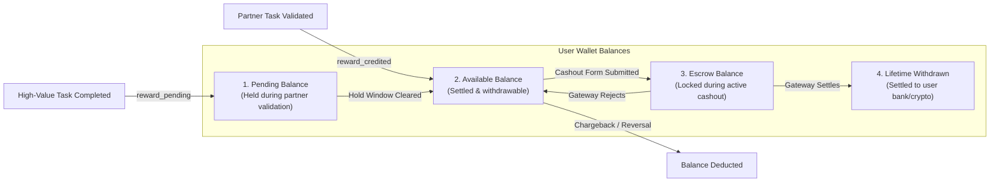
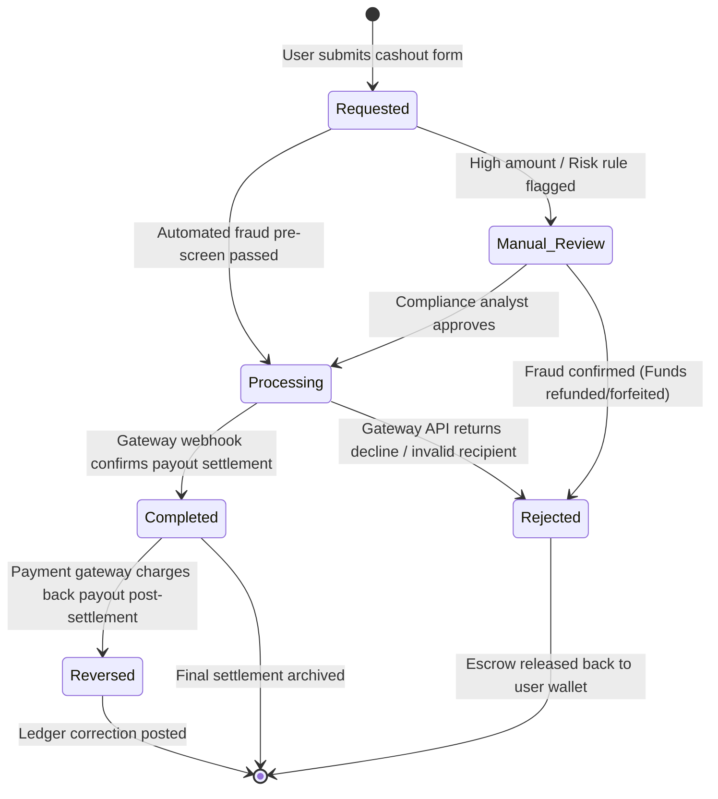

# Wallet & Withdrawal Analytics Specification
## VELOOP Rewards — Product Analytics, Data Readiness & Data Management Blueprint
**Deliverable Code:** `DELIV-06` (Work Package D)  
**Author / Analyst:** Pushti Kotak  
**Document Classification:** Internal Technical Architecture / Specification  
**Date:** 02 November 2026  
**Status:** Complete & Verified  

---

## 1. Objective & Financial Integrity Standards

The **Wallet & Withdrawal Analytics Specification** establishes the double-entry transaction architecture, balance segregation models, and cashout lifecycle telemetry for VELOOP Rewards.

In an online rewards platform, the wallet represents the primary interface of trust between the user and the company. Inaccurate balances, delayed cashouts, untracked deductions, or race-condition exploits during withdrawals cause severe reputational damage and catastrophic financial losses. 

This specification enforces:
1. **An Immutable Double-Entry Transaction Ledger** ensuring zero arbitrary balance updates.
2. **Strict Multi-State Balance Segregation** (*Available*, *Pending*, *Escrow-Locked*, *Withdrawn*).
3. **The Complete Withdrawal State Machine** (*Requested $\rightarrow$ Processing $\rightarrow$ Completed / Rejected / Reversed*).
4. **Formal KPI Definitions for Cashout Operations** complying with the 9-part metric specification standard.

---

## 2. D1. Wallet Transaction Ledger Model

To prevent race conditions and balance discrepancies, **user balances are never modified as raw overwritten scalars in a single column**. Every financial mutation is recorded as an immutable ledger transaction (`fct_wallet_transactions`) with an explicit debit/credit orientation:

```
Current Balance = SUM(Credit Transactions) - SUM(Debit Transactions)
```



### Analytical Schema: `fct_wallet_transactions`

| Attribute Name | Data Type | Required? | Description & Analytical Purpose | Ingestion Source | Validation / Constraints | Status |
|:---|:---|:---|:---|:---|:---|:---|
| `transaction_id` | `VARCHAR(36)` | **Yes** | Primary key; unique identifier for the ledger mutation. | Backend Ledger Service | UUIDv4 format (`tx_[0-9a-f-]{36}`) | **Confirmed** |
| `user_id` | `VARCHAR(36)` | **Yes** | Foreign key linking mutation to the account. | Auth Context | Valid UUIDv4 in `dim_users` | **Confirmed** |
| `timestamp` | `TIMESTAMP` | **Yes** | Exact UTC moment transaction was committed to the ledger. | Database Engine | UTC timestamp; $\le \text{CURRENT\_TIMESTAMP}$ | **Confirmed** |
| `transaction_type`| `VARCHAR(30)` | **Yes** | Economic classification of the balance mutation. | Transaction Engine | See Allowed Values below | **Confirmed** |
| `direction` | `VARCHAR(6)` | **Yes** | Direction of balance movement (`CREDIT` or `DEBIT`). | Transaction Engine | `CREDIT` (adds funds) or `DEBIT` (removes funds) | **Confirmed** |
| `amount` | `DECIMAL(12, 2)`| **Yes** | Numeric quantity of virtual currency transacted. | Transaction Engine | Strict positive decimal ($> 0.00$) | **Confirmed** |
| `unit` | `VARCHAR(10)` | **Yes** | Unit of account for the transaction. | Transaction Engine | `VE`, `XP`, `GEMS`, `USD`, `INR` | **Confirmed** |
| `balance_before` | `DECIMAL(12, 2)`| **Yes** | User available balance immediately prior to this transaction. | Ledger Worker | Numeric $\ge 0.00$; snapshot for audit | **Proposed** |
| `balance_after` | `DECIMAL(12, 2)`| **Yes** | User available balance immediately following transaction. | Ledger Worker | Mathematically: `balance_before +/- amount` | **Proposed** |
| `source` | `VARCHAR(30)` | **Yes** | Product module originating the transaction. | Service Registry | `Offerwall_Postback`, `Daily_Streak`, `Spin_Wheel`, `Referral_Bonus`, `Withdrawal_Cashout`, `Support_Adjustment` | **Confirmed** |
| `reference_id` | `VARCHAR(64)` | **Yes** | Foreign key to underlying trigger record. | Originating Service | Pointer to `task_activity_id`, `withdrawal_id`, or `ticket_id` | **Confirmed** |
| `parent_tx_id` | `VARCHAR(36)` | No | Links reversal/correction transactions to the original transaction. | Reversal Engine | Valid UUIDv4 of original `transaction_id` or `NULL` | **Confirmed** |
| `reversal_reason`| `VARCHAR(50)` | No | Causal categorization if transaction is a reversal/adjustment. | Reversal Engine | `Advertiser_Chargeback`, `Multi_Account_Fraud`, `Manual_Support_Fix`, `Gateway_Decline` | **Confirmed** |

### Transaction Type Inventory & Classification

| Transaction Type | Direction | Balance Bucket Affected | Description | Status |
|:---|:---|:---|:---|:---|
| `REWARD_CREDIT` | `CREDIT` | `Available_Balance` | Standard credit awarded upon verified task completion. | **Confirmed** |
| `REWARD_PENDING_HOLD` | `CREDIT` | `Pending_Balance` | Escrow credit held during verification lookback window. | **Confirmed** |
| `PENDING_RELEASE` | `CREDIT` | `Available_Balance` | Release of funds from pending into available balance. | **Confirmed** |
| `DAILY_BONUS_CREDIT`| `CREDIT` | `Available_Balance` | Check-in or streak habit incentive credit. | **Confirmed** |
| `REFERRAL_CREDIT` | `CREDIT` | `Available_Balance` | Commission earned when referred user activates. | **Confirmed** |
| `WITHDRAWAL_ESCROW` | `DEBIT` | `Available_Balance` | Funds temporarily locked in escrow when user submits cashout. | **Confirmed** |
| `WITHDRAWAL_SETTLED`| `DEBIT` | `Escrow_Balance` | Final debiting from escrow upon gateway confirmation. | **Confirmed** |
| `WITHDRAWAL_REFUND` | `CREDIT` | `Available_Balance` | Escrow funds returned to available balance upon failed cashout. | **Confirmed** |
| `REWARD_REVERSAL` | `DEBIT` | `Available_Balance` | Partner chargeback clawback following invalid lead detection. | **Confirmed** |
| `ADMIN_ADJUSTMENT` | `CREDIT/DEBIT`| `Available_Balance` | Discretionary customer support manual reconciliation. | **Proposed** |
| `CURRENCY_EXCHANGE`| `DEBIT/CREDIT`| `Available_Balance` | Conversion between virtual points (VE) and fiat equivalents. | **Proposed** |

---

## 3. D2. Withdrawal Lifecycle & State Machine

Cashouts represent the transition of platform virtual points into legal fiat or digital store value. The withdrawal state machine must ensure that funds are never double-spent while processing:



### Analytical Schema: `fct_withdrawals`

| Field Name | Data Type | Required? | Description & Analytical Purpose | Ingestion Source | Validation / Constraints | Status |
|:---|:---|:---|:---|:---|:---|:---|
| `withdrawal_id` | `VARCHAR(36)` | **Yes** | Primary key for the withdrawal transaction. | Backend Payout Service | UUIDv4 format (`wth_[0-9a-f-]{36}`) | **Confirmed** |
| `user_id` | `VARCHAR(36)` | **Yes** | Foreign key linking payout to user account. | Auth Context | Valid UUIDv4 in `dim_users` | **Confirmed** |
| `requested_amount`| `DECIMAL(10, 2)`| **Yes** | Gross virtual currency amount submitted by user. | Cashout Form | Numeric $\ge \text{minimum\_payout\_threshold}$ | **Confirmed** |
| `fee_amount` | `DECIMAL(6, 2)` | **Yes** | Gateway processing fee deducted from transaction. | Fee Engine | Numeric $\ge 0.00$; defaults to standard tier fee | **Proposed** |
| `net_payout_amount`| `DECIMAL(10, 2)`| **Yes** | Actual fiat/crypto value dispatched to user. | Payout Engine | `requested_amount - fee_amount` | **Confirmed** |
| `currency` | `CHAR(3)` | **Yes** | Target payout currency code. | Cashout Form | ISO 4217 code (`USD`, `INR`, `EUR`, `GBP`) | **Confirmed** |
| `payout_method` | `VARCHAR(20)` | **Yes** | Payout channel chosen by user. | Cashout Form | `PayPal`, `UPI_Direct`, `Bank_Transfer`, `Crypto_USDT`, `Amazon_Gift_Card` | **Confirmed** |
| `destination_hash`| `VARCHAR(64)` | **Yes** | SHA-256 hash of payment handle (email/UPI ID/wallet). | Ingestion Pipeline | Hashed string; raw handle stored encrypted in Vault | **Proposed** |
| `requested_timestamp`| `TIMESTAMP` | **Yes** | Exact moment user submitted cashout request. | API Gateway | UTC timestamp; $\le \text{CURRENT\_TIMESTAMP}$ | **Confirmed** |
| `processing_timestamp`| `TIMESTAMP` | No | Moment payout was dispatched to external gateway. | Batch Dispatch Worker | UTC timestamp; $\ge \text{requested\_timestamp}$ or `NULL` | **Confirmed** |
| `final_timestamp` | `TIMESTAMP` | No | Moment terminal state (Completed/Rejected) reached. | Gateway Webhook | UTC timestamp; $\ge \text{processing\_timestamp}$ or `NULL`| **Confirmed** |
| `status` | `VARCHAR(20)` | **Yes** | Current lifecycle status of the withdrawal. | Payout Engine | `Requested`, `Under_Review`, `Processing`, `Completed`, `Rejected`, `Reversed` | **Confirmed** |
| `reason_category` | `VARCHAR(50)` | No | Causal reason if withdrawal is rejected or reversed. | Gateway / Compliance | `KYC_Failed`, `Invalid_Account`, `Insufficient_Funds`, `Partner_Fraud_Flag`, `Country_Restricted` | **Confirmed** |
| `gateway_tx_id` | `VARCHAR(64)` | No | External reference ID returned by payment processor. | Payment Gateway | External provider transaction string | **Confirmed** |

---

## 4. D3. Withdrawal KPI Specifications (Catalogue Standard)

In accordance with Section 11 (D3) and Section 15 (I1), the 10 core withdrawal performance indicators are defined below using the **mandatory 9-part metric specification format**:

### 1. Withdrawal Requests
* **Definition:** Total gross count of withdrawal payout requests initiated by users within the reporting window.
* **Formula:** $\sum \text{COUNT}(\text{withdrawal\_id}) \quad \forall \; \text{status} \in \{\text{All}\}$
* **Required Fields:** `withdrawal_id`, `requested_timestamp`
* **Data Source:** `fct_withdrawals`
* **Frequency:** Daily / Hourly
* **Stakeholder:** Operations / Finance
* **Business Purpose:** Measures gross liquidity demand and cashout volume trends.
* **Interpretation:** Sudden spikes indicate viral user milestone achievement or potential multi-accounting exploitation.
* **Limitation:** Includes fraudulent, rejected, and canceled attempts; does not reflect actual cash disbursed.
* **Status:** Confirmed

### 2. Completed Withdrawals
* **Definition:** Total count of payout requests successfully settled and confirmed by the payment gateway.
* **Formula:** $\sum \text{COUNT}(\text{withdrawal\_id}) \quad \text{WHERE } \text{status} = \text{'Completed'}$
* **Required Fields:** `withdrawal_id`, `status`, `final_timestamp`
* **Data Source:** `fct_withdrawals`
* **Frequency:** Daily
* **Stakeholder:** Finance / Leadership
* **Business Purpose:** Tracks realized platform value delivery to users.
* **Interpretation:** Primary indicator of operational cashout success and platform fulfillment capability.
* **Limitation:** Does not reflect post-settlement chargebacks that occur weeks later.
* **Status:** Confirmed

### 3. Pending Withdrawals
* **Definition:** Total count of payout requests currently awaiting compliance screening or gateway dispatch.
* **Formula:** $\sum \text{COUNT}(\text{withdrawal\_id}) \quad \text{WHERE } \text{status} \in \{\text{'Requested'}, \text{'Under\_Review'}, \text{'Processing'}\}$
* **Required Fields:** `withdrawal_id`, `status`
* **Data Source:** `fct_withdrawals`
* **Frequency:** Real-time / Hourly
* **Stakeholder:** Operations Lead
* **Business Purpose:** Measures operational backlog and potential payment processing bottlenecks.
* **Interpretation:** Values above normal baseline indicate payment gateway downtime or compliance team backlogs.
* **Limitation:** A high pending count is expected immediately following monthly reward settlement batches.
* **Status:** Confirmed

### 4. Rejected Withdrawals
* **Definition:** Total count of payout requests declined due to compliance violations, invalid accounts, or gateway errors.
* **Formula:** $\sum \text{COUNT}(\text{withdrawal\_id}) \quad \text{WHERE } \text{status} = \text{'Rejected'}$
* **Required Fields:** `withdrawal_id`, `status`, `reason_category`
* **Data Source:** `fct_withdrawals`
* **Frequency:** Daily
* **Stakeholder:** Fraud & Risk / Customer Support
* **Business Purpose:** Identifies bad user account details, payment route failures, and attempted abuse.
* **Interpretation:** Elevated rejection rates indicate poor user guidance on payout forms or tightening fraud filters.
* **Limitation:** Legitimate users with minor typing errors are counted identically to malicious bots.
* **Status:** Confirmed

### 5. Reversed Withdrawals
* **Definition:** Count of settled payouts that were subsequently reclaimed or canceled by the payment processor.
* **Formula:** $\sum \text{COUNT}(\text{withdrawal\_id}) \quad \text{WHERE } \text{status} = \text{'Reversed'}$
* **Required Fields:** `withdrawal_id`, `status`, `parent_tx_id`
* **Data Source:** `fct_withdrawals`
* **Frequency:** Weekly / Monthly
* **Stakeholder:** Finance / Legal
* **Business Purpose:** Tracks catastrophic payment clawbacks, account takeover fraud, and banking reversals.
* **Interpretation:** Should remain close to zero; $> 0.5\%$ indicates severe vulnerability in payout authentication.
* **Limitation:** Reversal notifications often arrive with 30–60 days of latency from external banks.
* **Status:** Confirmed

### 6. Payout Processing Time (Median Duration)
* **Definition:** The median elapsed time in hours between user withdrawal submission and final gateway confirmation.
* **Formula:** $\text{MEDIAN}(\text{final\_timestamp} - \text{requested\_timestamp}) \quad \text{WHERE } \text{status} = \text{'Completed'}$
* **Required Fields:** `requested_timestamp`, `final_timestamp`, `status`
* **Data Source:** `fct_withdrawals`
* **Frequency:** Daily
* **Stakeholder:** Product / Operations
* **Business Purpose:** Measures core user experience speed and SLA compliance for payouts.
* **Interpretation:** Faster settlement times directly increase user retention and net promoter scores (NPS).
* **Limitation:** Influenced by weekend banking holidays and regional payment infrastructure outside VELOOP control.
* **Status:** Confirmed

### 7. Withdrawal Completion Rate
* **Definition:** The proportion of submitted withdrawal requests that successfully settle without rejection or reversal.
* **Formula:** $\frac{\text{Completed Withdrawals}}{\text{Completed} + \text{Rejected} + \text{Reversed Withdrawals}} \times 100\%$
* **Required Fields:** `status`
* **Data Source:** `fct_withdrawals`
* **Frequency:** Weekly
* **Stakeholder:** Executive Management
* **Business Purpose:** High-level platform health metric evaluating end-to-end cashout reliability.
* **Interpretation:** World-class target is $> 95\%$; drop below $90\%$ requires urgent payment routing investigation.
* **Limitation:** Skewed lower during targeted bot-attack waves that produce hundreds of rejected requests.
* **Status:** Confirmed

### 8. Pending Queue Age (Hours)
* **Definition:** The average age in hours of all unresolved withdrawal requests currently sitting in the pending queue.
* **Formula:** $\text{AVG}(\text{CURRENT\_TIMESTAMP} - \text{requested\_timestamp}) \quad \text{WHERE } \text{status} \in \{\text{'Requested'}, \text{'Under\_Review'}\}$
* **Required Fields:** `requested_timestamp`, `status`
* **Data Source:** `fct_withdrawals`
* **Frequency:** Hourly Alert
* **Stakeholder:** Operations Lead
* **Business Purpose:** Operational queue SLA monitoring to prevent payout stagnation.
* **Interpretation:** Any queue age exceeding 48 hours triggers an immediate operations escalation alert.
* **Limitation:** Does not reflect queue volume; a single stalled request can skew average age upward.
* **Status:** Confirmed

### 9. Total Withdrawal Volume (USD / Fiat)
* **Definition:** The cumulative fiat currency value of all completed withdrawals settled within the reporting period.
* **Formula:** $\sum \text{net\_payout\_amount} \quad \text{WHERE } \text{status} = \text{'Completed'}$
* **Required Fields:** `net_payout_amount`, `currency`, `status`, `final_timestamp`
* **Data Source:** `fct_withdrawals`
* **Frequency:** Daily / Monthly
* **Stakeholder:** Finance / Treasury
* **Business Purpose:** Core financial treasury metric tracking cash outflow and working capital requirements.
* **Interpretation:** Must be evaluated directly against verified partner receivables to ensure platform solvency.
* **Limitation:** Must be normalized into a single base reporting currency (USD) across diverse multi-currency payouts.
* **Status:** Confirmed

### 10. Payout Method Distribution (%)
* **Definition:** Percentage breakdown of completed withdrawal transactions across individual payment channels.
* **Formula:** $\frac{\text{Completed Withdrawals for Method } M}{\text{Total Completed Withdrawals}} \times 100\%$
* **Required Fields:** `payout_method`, `status`
* **Data Source:** `fct_withdrawals`
* **Frequency:** Monthly
* **Stakeholder:** Product / Partnerships
* **Business Purpose:** Informs gateway contract negotiations and identifies preferred regional payout rails.
* **Interpretation:** High concentration in PayPal vs. UPI vs. Crypto guides fee optimization and regional feature rollouts.
* **Limitation:** Heavily influenced by regional user acquisition mix rather than intrinsic channel preference.
* **Status:** Confirmed

---
*End of Deliverable DELIV-06 — Wallet & Withdrawal Analytics Specification.*
