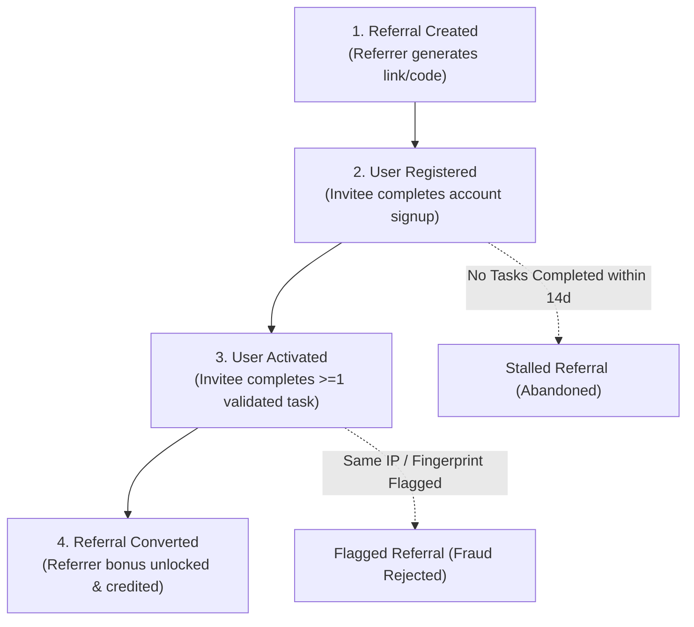

# Referral & Engagement Analytics Specification
## VELOOP Rewards — Product Analytics, Data Readiness & Data Management Blueprint
**Deliverable Code:** `DELIV-07` (Work Package E)  
**Author / Analyst:** Pushti Kotak  
**Document Classification:** Internal Technical Architecture / Specification  
**Date:** 02 November 2026  
**Status:** Complete & Verified  

---

## 1. Objective & Behavioral Framework

The **Referral & Engagement Analytics Specification** defines the structural models required to measure viral growth loops, user habituation, feature adoption, and longitudinal platform retention for VELOOP Rewards.

Growth in a rewards platform depends heavily on peer-to-peer referral mechanisms. However, rewarding users purely for generating registrations invites fraudulent bot-farming, fake accounts, and rapid balance drain without real user acquisition. 

This specification establishes:
1. **The 4-Stage Referral Progression Funnel** (*Created $\rightarrow$ Registered $\rightarrow$ Activated $\rightarrow$ Converted*).
2. **Referral Attribution Schema & Fraud Mitigation Standards**.
3. **Multi-Tier Engagement Measurement Framework** covering Feature Adoption, Frequency, Stickiness (DAU/MAU), and Activity Cohorts.

---

## 2. E1. The 4-Stage Referral Funnel & Data Specification

A fundamental requirement of Section 11 is **never to equate registration with successful referral conversion**. Referral incentives are recognized as a platform liability only when the referred user creates real commercial value.

1. **Referral Created (`referral_created`):** The referrer requests a unique shareable tracking URL or referral code from the app.
2. **User Registered (`referral_registered`):** The invitee visits the link, passes captcha, and completes account creation. The attribution link between `referrer_user_id` and `referred_user_id` is created in a pending state.
3. **User Activated (`referral_activated`):** The invitee completes their first verified earning task (e.g., completes a validated survey, installs and opens an app) or earns a minimum baseline of 100 VEs.
4. **Referral Converted (`referral_converted`):** Fraud screening checks pass (verifying the invitee and referrer are on different devices and IP subnets), and the referral bonus is formally credited to the referrer’s wallet.

### Analytical Schema: `fct_referrals`

| Field Name | Data Type | Required? | Description & Analytical Purpose | Ingestion Source | Validation / Constraints | Status |
|:---|:---|:---|:---|:---|:---|:---|
| `referral_id` | `VARCHAR(36)` | **Yes** | Primary key for this unique referral attribution pair. | Backend Referral Engine | UUIDv4 format (`ref_[0-9a-f-]{36}`) | **Confirmed** |
| `referrer_user_id`| `VARCHAR(36)` | **Yes** | User ID of the member who shared the invitation. | Auth Context | Valid UUIDv4 in `dim_users` | **Confirmed** |
| `referred_user_id`| `VARCHAR(36)` | No | User ID of the newly registered invitee. | Registration Event | Valid UUIDv4 in `dim_users` or `NULL` (pre-reg) | **Confirmed** |
| `referral_code` | `VARCHAR(20)` | **Yes** | Alphanumeric campaign/vanity code used. | Referral Service | Uppercase alphanumeric string (e.g., `VELOOP_PUSHTI`) | **Confirmed** |
| `share_channel` | `VARCHAR(30)` | No | Social/messaging medium used to distribute the link. | Client Share Intent | `WhatsApp`, `Telegram`, `Twitter_X`, `Direct_Link`, `YouTube` | **Proposed** |
| `creation_timestamp`| `TIMESTAMP` | **Yes** | Moment referral link/code was generated by referrer. | Backend API | UTC timestamp; $\le \text{CURRENT\_TIMESTAMP}$ | **Confirmed** |
| `registration_timestamp`| `TIMESTAMP`| No | Moment referred user completed registration. | Auth Service | UTC timestamp; $\ge \text{creation\_timestamp}$ or `NULL` | **Confirmed** |
| `activation_timestamp`| `TIMESTAMP` | No | Moment referred user completed their first validated task. | Task Worker | UTC timestamp; $\ge \text{registration\_timestamp}$ or `NULL` | **Confirmed** |
| `conversion_timestamp`| `TIMESTAMP` | No | Moment referral bonus was committed to referrer ledger. | Reward Worker | UTC timestamp; $\ge \text{activation\_timestamp}$ or `NULL` | **Confirmed** |
| `referral_status` | `VARCHAR(20)` | **Yes** | Current lifecycle status of the referral pair. | Referral Engine | `Link_Created`, `Registered`, `Activated`, `Converted`, `Fraud_Blocked` | **Confirmed** |
| `reward_amount` | `DECIMAL(10,2)`| **Yes** | Virtual reward amount credited to referrer upon conversion. | Reward Policy Table | Numeric $\ge 0.00$ (e.g., 250.00 VEs) | **Confirmed** |
| `reward_unit` | `VARCHAR(10)` | **Yes** | Currency unit of referral commission. | Reward Policy Table | `VE`, `XP`, `GEMS` | **Confirmed** |
| `ip_collision_flag`| `BOOLEAN` | **Yes** | Flag indicating whether referrer and invitee shared an IP subnet. | Ingestion Pipeline | `TRUE` if IP hash matches; defaults to `FALSE` | **Proposed** |

---

## 3. E2. Engagement Analytics Framework

Engagement analytics evaluates how deeply, frequently, and consistently users interact with VELOOP’s various earning and gamification features.

```mermaid
flowchart LR
    subgraph Frequency["1. User Activity Cadence"]
        DAU["DAU: Daily Active Users"]
        WAU["WAU: Weekly Active Users"]
        MAU["MAU: Monthly Active Users"]
        Stickiness["Stickiness Ratio: DAU / MAU"]
    end

    subgraph FeatureMix["2. Feature Portfolio Adoption"]
        Surveys["Surveys & Polls"]
        Games["Game Milestones"]
        Streaks["Daily Streaks"]
        Spins["Daily Spin Wheel"]
        Quests["Missions & Badges"]
    end

    subgraph Retention["3. Lifecycle Cohorting"]
        Day1["Day 1 Retention"]
        Day7["Day 7 Retention"]
        Day30["Day 30 Retention"]
    end

    Frequency --> FeatureMix --> Retention
```

### 1. Active User Definitions
* **Daily Active User (DAU):** A unique `user_id` generating at least one qualifying productive event (`task_started`, `task_completed`, `daily_reward_claimed`, `spin_completed`, `withdrawal_requested`) within a 24-hour UTC calendar day.
  * *Exclusion Rule:* Background push notifications, passive app opening without user interaction, and automated cron executions are **explicitly excluded** from DAU calculations.
* **Weekly Active User (WAU):** A unique `user_id` generating at least one qualifying productive event within the trailing 7 rolling calendar days.
* **Monthly Active User (MAU):** A unique `user_id` generating at least one qualifying productive event within the trailing 30 rolling calendar days.
* **Platform Stickiness Ratio ($DAU / MAU$):** Measures the frequency with which monthly users return on a daily basis. Industry benchmark for top-tier rewards apps is $18\%–28\%$.

### 2. Feature Adoption & Breadth Metrics
* **Feature Adoption Rate (%):** Proportion of an active cohort that interacts with a specific feature within their first 7 days:
  $$\text{Adoption Rate}_F = \frac{\text{Unique Users executing feature } F \text{ in Day 0–7}}{\text{Total Registered Users in Cohort}} \times 100\%$$
* **Multi-Feature Usage Score:** Measures feature cross-pollination. Users who interact with $\ge 3$ distinct product features (e.g., Tasks + Daily Streaks + Spin Wheel) exhibit significantly higher 30-day retention and lifetime value than single-feature users.
* **Feature Execution Frequency:** Average completions per active user per day/week for each individual module:
  $$\text{Frequency}_F = \frac{\text{Total Event Count for Feature } F}{\text{DAU on Day } t}$$

### 3. Repeat Usage & Habituation (Streaks & Quests)
* **Daily Streak Continuance Rate (%):** Probability that a user who claimed a Day $N$ streak reward successfully claims Day $N+1$:
  $$P(\text{Streak } N+1 \mid \text{Streak } N) = \frac{\text{Users Claiming Day } N+1}{\text{Users Claiming Day } N} \times 100\%$$
* **Broken Streak Recovery Rate (%):** Percentage of users who return to restart a streak within 48 hours of missing a day. Measures user resilience vs. demotivation.

---

## 4. Fraud Mitigation & Anti-Sybil Controls

To safeguard the referral budget from sybil attacks, the following analytical fraud filters are embedded in the pipeline:
1. **Device Fingerprint Deduplication:** No referral bonus is unlocked if `referred_user_id` shares a hardware fingerprint hash (`device_fingerprint_hash`) with `referrer_user_id` or any previously registered account.
2. **Velocity Capping:** An alert is triggered if a single `referrer_user_id` generates $> 20$ registered referrals within a 1-hour window. Subsequent payouts are placed in `Manual_Review`.
3. **Closed-Loop Qualification:** Referral bonuses are strictly conditional on the invitee generating at least \$0.50 in verified gross advertiser revenue.

---
*End of Deliverable DELIV-07 — Referral & Engagement Analytics Specification.*
