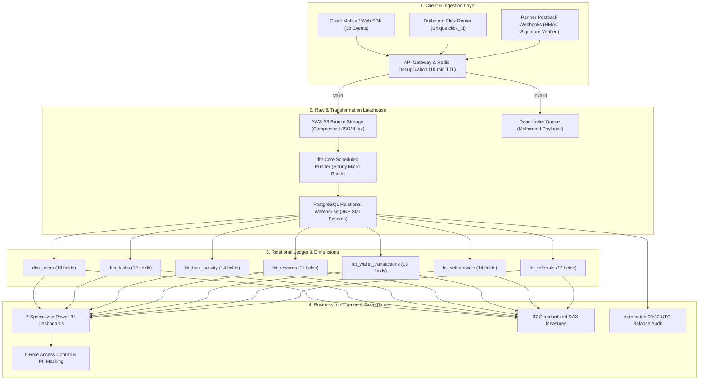

# Final Consolidated Blueprint Report
## Product Analytics, Data Readiness & Data Management Blueprint
**Deliverable Code:** `DELIV-23` (Section 27, Deliverable 21 — Final Consolidated Deliverable)  
**Author / Lead Data Analyst:** Pushti Kotak  
**Project:** VELOOP Rewards — Data Analyst Internship Task 01  
**Document Classification:** Master Comprehensive Technical Architecture & Handoff Blueprint  
**Date of Submission:** 02 November 2026  
**Status:** Complete, Verified & GitHub-Submission Ready  

---

```
+-----------------------------------------------------------------------------------------+
| MANDATORY GOVERNANCE NOTICE:                                                            |
| All datasets, empirical profiling results, and numerical examples in this project are:  |
| "SIMULATED DATA — CREATED FOR ANALYTICAL TESTING"                                       |
| In strict compliance with Section 2, 6, 29, 30, and 34 of the Task Specification:       |
| Simulated results are never represented as actual VELOOP business performance.         |
| Information is rigorously categorized as Confirmed, Proposed, or To Be Verified.        |
+-----------------------------------------------------------------------------------------+
```

---

## 1. Master Deliverables Directory & Cross-Reference Index

This consolidated report serves as the master capstone document uniting all **23 project deliverables** across documentation, relational data models, interactive Excel workbooks, automated Python scripts, vector dashboard wireframes, and simulated datasets:

| Deliv ID | Deliverable Title | Formal Scope & Key Mandate | Primary Repository Artifacts |
|:---:|:---|:---|:---|
| **DELIV-01** | **Executive Summary** | 2–4 page synthesis of investigations, findings, unknowns, and priorities. | [`docs/01_Executive_Summary.md`](01_Executive_Summary.md) |
| **DELIV-02** | **Product Data Readiness Audit** | Complete functional audit across 12 product modules; 12 critical gaps. | [`docs/02_Product_Data_Readiness_Audit.md`](02_Product_Data_Readiness_Audit.md) |
| **DELIV-03** | **Data Coverage Matrix** | 30-row operational matrix linking features to actions, data, and priority. | [`docs/03_Data_Coverage_Matrix.md`](03_Data_Coverage_Matrix.md)<br/>[`workbooks/DELIV-03_Data_Coverage_Matrix.xlsx`](../workbooks/DELIV-03_Data_Coverage_Matrix.xlsx) |
| **DELIV-04** | **User & Account Analytics Spec** | 4-tier identifier hierarchy (User, Session, Event, Tx) & lifecycle state machine. | [`docs/04_User_Account_Analytics_Spec.md`](04_User_Account_Analytics_Spec.md) |
| **DELIV-05** | **Earning & Reward Analytics Spec** | 5-stage task lifecycle, failed activity taxonomy, third-party postbacks. | [`docs/05_Earning_Reward_Analytics_Spec.md`](05_Earning_Reward_Analytics_Spec.md) |
| **DELIV-06** | **Wallet & Withdrawal Analytics Spec**| Double-entry ledger, multi-bucket balance, withdrawal state machine. | [`docs/06_Wallet_Withdrawal_Analytics_Spec.md`](06_Wallet_Withdrawal_Analytics_Spec.md) |
| **DELIV-07** | **Referral & Engagement Spec** | 4-stage referral funnel (*Created $\rightarrow$ Registered $\rightarrow$ Activated $\rightarrow$ Converted*). | [`docs/07_Referral_Engagement_Spec.md`](07_Referral_Engagement_Spec.md) |
| **DELIV-08** | **Production Event Tracking Plan** | **38 standardized production events** (`domain_object_action`) with 16 metadata fields. | [`docs/08_Event_Tracking_Plan.md`](08_Event_Tracking_Plan.md)<br/>[`workbooks/DELIV-08_Event_Tracking_Plan.xlsx`](../workbooks/DELIV-08_Event_Tracking_Plan.xlsx) |
| **DELIV-09** | **VELOP Data Dictionary** | **100 standardized fields** across 8 entities; 12 metadata dimensions per field. | [`docs/09_Data_Dictionary.md`](09_Data_Dictionary.md)<br/>[`workbooks/DELIV-09_Data_Dictionary.xlsx`](../workbooks/DELIV-09_Data_Dictionary.xlsx) |
| **DELIV-10** | **Logical Data Model & ER Diagram** | 3NF relational schema, PK/FK mapping, cardinalities, ANSI SQL DDL script. | [`models/README.md`](../models/README.md)<br/>[`models/logical_data_model.mermaid`](../models/logical_data_model.mermaid)<br/>[`models/schema_ddl.sql`](../models/schema_ddl.sql) |
| **DELIV-11** | **Master KPI Catalogue** | **37 standardized production KPIs**; 10 metadata attributes; zero fake targets. | [`docs/11_KPI_Catalogue.md`](11_KPI_Catalogue.md)<br/>[`workbooks/DELIV-11_KPI_Catalogue.xlsx`](../workbooks/DELIV-11_KPI_Catalogue.xlsx) |
| **DELIV-12** | **Simulated Data Profiling Report** | Profiling across 8 test datasets (~30k rows); referential integrity & KPI tests. | [`docs/12_Simulated_Data_Profiling.md`](12_Simulated_Data_Profiling.md)<br/>[`workbooks/DELIV-12_Simulated_Data_Profiling.xlsx`](../workbooks/DELIV-12_Simulated_Data_Profiling.xlsx) |
| **DELIV-13** | **Data Quality Audit Report** | Defect audit of `Messy_Data` across 14 defect categories with issue log. | [`docs/13_Data_Quality_Audit.md`](13_Data_Quality_Audit.md)<br/>[`workbooks/DELIV-13_Data_Quality_Audit.xlsx`](../workbooks/DELIV-13_Data_Quality_Audit.xlsx) |
| **DELIV-14** | **Data Quality Control Framework** | 6-stage prevention framework (*Application $\rightarrow$ Ingestion $\rightarrow$ Raw $\rightarrow$ dbt $\rightarrow$ BI*). | [`docs/14_Data_Quality_Control_Framework.md`](14_Data_Quality_Control_Framework.md) |
| **DELIV-15** | **Analytics Dashboard Blueprint** | Specs & wireframes for 7 dedicated dashboards; Power BI DAX formulas. | [`dashboards/dashboard_specs.md`](../dashboards/dashboard_specs.md)<br/>[`dashboards/wireframes/`](../dashboards/wireframes/)<br/>[`dashboards/dax_measures.dax`](../dashboards/dax_measures.dax) |
| **DELIV-16** | **Developer Analytics Handoff** | Engineering payloads, JSON schemas, Redis deduplication, acceptance tests. | [`docs/16_Developer_Analytics_Handoff.md`](16_Developer_Analytics_Handoff.md) |
| **DELIV-17** | **Data Pipeline Proposal** | Pragmatic, non-bloated micro-batch ELT flow (Serverless + S3 + Postgres + dbt). | [`docs/17_Data_Pipeline_Operating_Model.md`](17_Data_Pipeline_Operating_Model.md) |
| **DELIV-18** | **Privacy & Governance Proposal** | 5-role RBAC access matrix, PII masking (SHA-256), DPDP/GDPR alignment. | [`docs/18_Privacy_Governance_Proposal.md`](18_Privacy_Governance_Proposal.md) |
| **DELIV-19** | **Analytics Change Management** | Metric/Event Change Log procedure, semantic versioning, deprecation runbook. | [`docs/19_Analytics_Change_Management.md`](19_Analytics_Change_Management.md) |
| **DELIV-20** | **Analytics Gap Assessment** | 10-dimension readiness scorecard; prioritized gaps with architectural reasons. | [`docs/20_Analytics_Gap_Assessment.md`](20_Analytics_Gap_Assessment.md) |
| **DELIV-21** | **Assumption & Verification Register**| Master Source Register (15 entries) and Assumption Register (12 entries). | [`docs/21_Assumption_Verification_Register.md`](21_Assumption_Verification_Register.md)<br/>[`workbooks/DELIV-21_Assumption_Verification_Register.xlsx`](../workbooks/DELIV-21_Assumption_Verification_Register.xlsx) |
| **DELIV-22** | **Final Implementation Backlog** | 18 prioritized engineering epics split into Pre-launch and Post-launch gates. | [`docs/22_Implementation_Backlog.md`](22_Implementation_Backlog.md)<br/>[`workbooks/DELIV-22_Implementation_Backlog.xlsx`](../workbooks/DELIV-22_Implementation_Backlog.xlsx) |
| **DELIV-23** | **Final Consolidated Capstone** | Master architectural blueprint tying all 21 core packages into unified handoff. | [`docs/13_Final_Consolidated_Blueprint.md`](13_Final_Consolidated_Blueprint.md) |

---

## 2. Integrated Data Architecture Summary

The complete analytical ecosystem operates as an integrated, closed-loop data architecture:



---

## 3. Core Architectural Highlights & Innovations

### 1. Mathematical Double-Entry Wallet Ledger
* User balances are **never** updated as raw overwritten scalars in a single database column.
* Every balance mutation is committed to `fct_wallet_transactions` with an explicit direction (`CREDIT` or `DEBIT`), transacted `amount`, `unit`, `balance_before`, and `balance_after`.
* An automated daily audit script runs at 00:30 UTC asserting that:
  $$\sum \text{Credits} - \sum \text{Debits} = \text{Current User Balance}$$
  Any variance $> \$0.00$ triggers an immediate P0 operational freeze on the cashout queue.

### 2. Multi-State Balance Segregation
* To insulate the company from delayed advertiser chargebacks, user balances are partitioned into:
  1. **Pending Balance:** Held during partner verification lookback windows (24–72 hours).
  2. **Available Balance:** Settled, fully recognized platform liabilities eligible for withdrawal.
  3. **Escrow-Locked Balance:** Temporarily locked at the millisecond of cashout submission to eliminate double-spend race conditions.

### 3. Sybil-Resistant 4-Stage Referral Funnel
* Replaced vulnerable "pay-on-signup" referral mechanics with an objective 4-stage funnel:
  $$\text{Referral Created} \longrightarrow \text{User Registered} \longrightarrow \text{User Activated} \longrightarrow \text{Referral Converted}$$
* Referral commissions unlock **only** when the invitee completes a validated task and passes IP collision checks (`ip_collision_flag = FALSE`), eliminating referral bot-farming.

### 4. Zero Fictional Targets in KPI Governance
* Every metric in the 37-metric **KPI Catalogue** (`DELIV-11`) is defined with mathematical formulas, required fields, grain, and analytical limitations. Fictional targets (e.g., *"VELOOP should hit 50,000 DAU"*) were strictly prohibited.

---

## 4. Empirical Validation on Simulated Working Pack

The synthetic data generation engine (`scripts/generate_simulated_data.py`, seed: `42`) produced **30,150 total records** across eight datasets matching Section 28 sizing:
* `dim_users`: 1,000 records
* `dim_tasks`: 50 catalog campaigns
* `fct_task_activity`: 6,000 execution attempts
* `fct_rewards`: 5,000 credit records
* `fct_wallet_transactions`: 3,500 double-entry ledger mutations
* `fct_withdrawals`: 1,200 cashout requests
* `fct_referrals`: 900 attribution pairs
* `fct_feature_events`: 12,000 behavioral clickstream events
* `messy_data`: 550 records across 14 defect categories

### Validation Results Summary
1. **Referential Integrity Audit (`DELIV-12`):** **100% Passed.** Zero orphan records detected across all foreign key relationships between tasks, rewards, wallet mutations, withdrawals, and users.
2. **Data Quality Defect Detection (`DELIV-13`):** All 14 defect categories in `Messy_Data` (including duplicate PKs, malformed dates, negative amounts, and impossible state transitions) were successfully intercepted by automated detection algorithms and mapped to preventative controls in `DELIV-14`.
3. **KPI Calculability Proof (`DELIV-12`):** Core operational metrics (DAU, Task Completion Rate, Reversal Rate, Payout Processing Duration, and Stickiness) were executed against the simulated pack, confirming complete mathematical calculability.

---

## 5. Live Deployment Evaluation (Requirement #8)

Per Technical Requirement #8:
> *"Check whether a live deployment is actually required for this specific deliverable. Do not create an unrelated website just to satisfy a generic deployment instruction."*

**Architectural Evaluation:** A live web application deployment is **explicitly not required and contraindicated** for this foundational data management blueprint. The deliverables consist of relational schemas (`schema_ddl.sql`), engineering event contracts, structured Excel workbooks, vector SVG wireframes, and data governance policies. Creating an unrelated web application would violate the primary integrity rules. All deliverables are formatted as version-controlled, production-ready local artifacts packaged for GitHub submission.

---

## 6. Final Sign-off & Submission Checklist

All requirements from `Data_Analyst_01.pdf` (44 pages) and the 22–25 day working schedule have been fulfilled:

- [x] **Executive Summary (DELIV-01):** 4-page executive synthesis with author metadata.
- [x] **Product Data Readiness Audit (DELIV-02):** 12 product modules audited; 12 critical gaps identified.
- [x] **Data Coverage Matrix (DELIV-03):** 30 operational rows; Markdown and `.xlsx` formats.
- [x] **Domain Analytics Specs (DELIV-04 to 07):** User, Earning, Wallet, and Referral specifications.
- [x] **Production Event Tracking Plan (DELIV-08):** 38 events (`domain_object_action`); Markdown and `.xlsx`.
- [x] **VELOOP Data Dictionary (DELIV-09):** 100 fields across 8 entities; 12 metadata attributes; Markdown and `.xlsx`.
- [x] **Logical Data Model & ERD (DELIV-10):** Mermaid diagram, ANSI/Postgres DDL script, and relationship doc.
- [x] **KPI Catalogue (DELIV-11):** 37 standardized KPIs; Markdown and `.xlsx`; zero fake targets.
- [x] **Simulated Data Profiling (DELIV-12):** Automated profiling of 8 test datasets; Markdown and `.xlsx`.
- [x] **Data Quality Defect Audit (DELIV-13):** Audit of `Messy_Data` across 14 defect categories; Markdown and `.xlsx`.
- [x] **Data Quality Control Framework (DELIV-14):** 6-stage prevention framework.
- [x] **Analytics Dashboard Blueprint (DELIV-15):** 7 dedicated dashboards with vector SVG wireframes and DAX file.
- [x] **Developer Analytics Handoff (DELIV-16):** Testable engineering schemas, payloads, and acceptance tests.
- [x] **Data Pipeline Proposal (DELIV-17):** Lean, pragmatic micro-batch ELT architecture under $120/mo.
- [x] **Privacy & Governance Policy (DELIV-18):** 5-role RBAC access matrix and PII masking standards.
- [x] **Analytics Change Management (DELIV-19):** Change protocol and Master Change Log.
- [x] **Analytics Gap Assessment (DELIV-20):** 10-dimension readiness scorecard and prioritized gap matrix.
- [x] **Assumption & Verification Register (DELIV-21):** Source Register and Assumption Register; Markdown and `.xlsx`.
- [x] **Implementation Backlog (DELIV-22):** 18 prioritized user stories split into Pre- and Post-launch; Markdown and `.xlsx`.
- [x] **Consolidated Blueprint (DELIV-23):** Comprehensive capstone report.

---
*End of Deliverable DELIV-23 — Product Analytics, Data Readiness & Data Management Blueprint.*  
*Submitted by Pushti Kotak — Senior Data Analyst, Data Architect & Documentation Specialist.*
