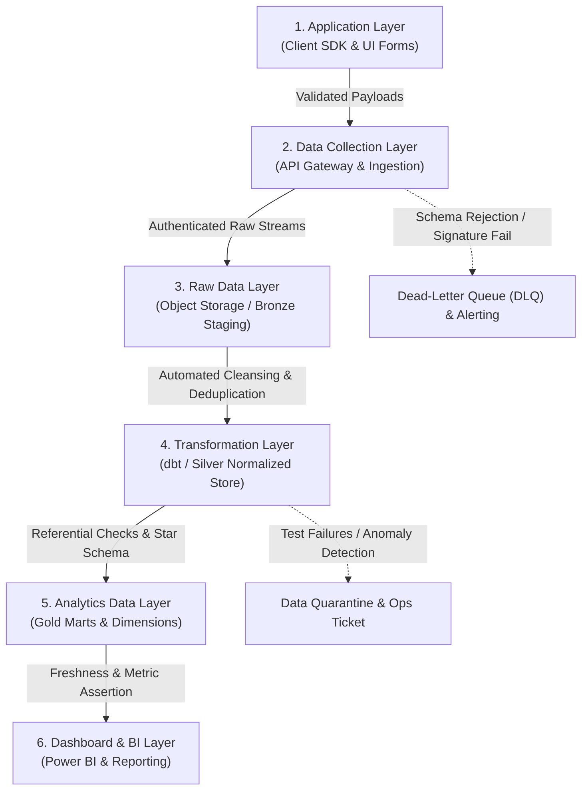
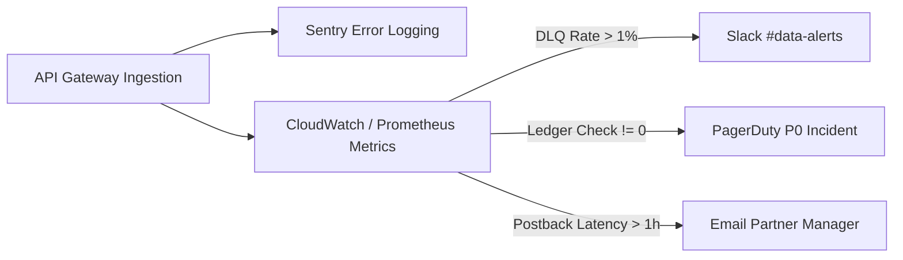

# Data Quality Control Framework
## VELOOP Rewards — Product Analytics, Data Readiness & Data Management Blueprint
**Deliverable Code:** `DELIV-14` (Work Package L)  
**Author / Analyst:** Pushti Kotak  
**Document Classification:** Internal Technical Architecture / Data Governance Framework  
**Date:** 02 November 2026  
**Status:** Complete & Verified  

---

## 1. Objective & Architectural Philosophy

The **Data Quality Control Framework** establishes an enterprise defense-in-depth architecture designed to prevent, intercept, and correct data defects across the entire data lifecycle. 

As established in Section 18 of the VELOOP Internship Task Specification:  
> *"Don't stop at identifying bad records. Design a system to prevent them."*

In an online rewards ecosystem, relying solely on downstream data analysts to find bad records in dashboards is a catastrophic failure. Corrupted events result in double-credited balances, unauthorized cashouts, uncollectible partner receivables, and skewed management reporting.

This framework maps data quality gates across **all six operating layers** of the VELOOP data architecture:

---

## 2. The 6-Stage Quality Control Matrix

| Stage | Operating Layer | Primary Quality Gate | Enforcement Mechanism | Failure Action | Responsible Owner |
|:---|:---|:---|:---|:---|:---|
| **01** | **Application** | Input Typing & Formatting | Client-side form regex; TypeScript strict typing; UUID generators. | Block user form submission; show inline error. | Frontend / Mobile Eng |
| **01** | **Application** | Duplicate Click Prevention | UI button debounce (disable button for 3s after click). | Prevent multi-click duplicate event dispatch. | Mobile Client Eng |
| **02** | **Data Collection**| Schema Validation | Pydantic / JSON Schema validation at API gateway endpoint. | Reject with HTTP 422 Unprocessable Entity. | Ingestion Gateway Eng |
| **02** | **Data Collection**| HMAC Webhook Security | Cryptographic hash signature verification on partner callbacks. | Reject with HTTP 401 Unauthorized; log IP. | Security / Partner Eng |
| **02** | **Data Collection**| Real-Time Deduplication | Redis distributed cache checking `event_id` (10-min TTL). | Acknowledge HTTP 200 but discard duplicate payload. | Platform Eng |
| **03** | **Raw Data** | Immutable Ingestion Staging| Append-only cloud object storage (S3/GCS); zero row updates. | Permanent raw record preservation for replay. | Data Platform Eng |
| **03** | **Raw Data** | Dead-Letter Queuing (DLQ)| Failed or unparseable JSON routed to isolated DLQ bucket. | Trigger automated Slack alert to on-call engineer. | DevOps / Data Ops |
| **04** | **Transformation**| String Normalization | Automated `TRIM()`, `UPPER()`, and `INITCAP()` SQL staging filters. | Automatically clean trailing spaces and messy cases. | Analytics Eng |
| **04** | **Transformation**| Idempotent Deduplication| SQL `ROW_NUMBER() OVER (PARTITION BY pk ORDER BY timestamp)` | Collapse identical retries to single earliest record. | Analytics Eng |
| **04** | **Transformation**| Date Parsing & Epoch Cast | Standardize all timestamps to UTC ISO-8601 (`TIMESTAMPTZ`). | Convert localized strings into canonical UTC. | Analytics Eng |
| **05** | **Analytics** | Referential Integrity | Foreign Key checks (`fct_task_activity.user_id IN dim_users`). | Flag orphan records; alert data governance lead. | Lead Data Architect |
| **05** | **Analytics** | Ledger Mathematical Balance| Check `SUM(credits) - SUM(debits) = stored_balance`. | P0 incident alert; freeze withdrawal queue for user. | DBA / Finance Lead |
| **05** | **Analytics** | State Machine Assertion | Assert valid transitions (`Started` $\rightarrow$ `Completed`). | Log `illegal_state_transition` defect record. | QA / Platform Eng |
| **06** | **Dashboard / BI**| Data Freshness SLA | Pipeline heartbeat test checking `MAX(server_timestamp)`. | Display "Data Stale (>2h)" warning banner on visual. | BI Specialist |
| **06** | **Dashboard / BI**| Metric Anomaly Alerting | Z-score anomaly detector on daily payout request volume. | Dispatch automated pager alert if $>3\sigma$ deviation. | Analytics Lead |

---

## 3. Concrete Quality Prevention Rules by Defect Category

### 1. ID & Key Validation
* **Operating Point:** *Data Collection Layer (API Gateway)*
* **Rule:** Every event payload must contain an `event_id` matching regex `^evt_[0-9a-f]{8}-[0-9a-f]{4}-4[0-9a-f]{3}-[89ab][0-9a-f]{3}-[0-9a-f]{12}$`.
* **Prevention:** The API gateway rejects malformed or missing event IDs before events hit the event streaming bus.

### 2. Status & Enum Allowed Values
* **Operating Point:** *Transformation Layer (dbt) & Database Layer*
* **Rule:** Status fields must belong strictly to predefined domain enumerations (e.g., `dim_users.account_status` $\in$ `('Registered', 'Onboarded', 'Active', 'Dormant', 'Churned', 'Suspended', 'Banned')`).
* **Prevention:** Enforced via ANSI SQL `CHECK` constraints on PostgreSQL relational tables and automated dbt schema tests (`accepted_values`).

### 3. Duplicate Transaction Elimination
* **Operating Point:** *Data Collection & Application Layer*
* **Rule:** A partner postback containing a previously processed `external_tx_id` from the same `provider_id` must never generate a second ledger credit.
* **Prevention:** Enforce a composite unique constraint on `(provider_id, external_tx_id)` in `fct_task_activity`. Replays return HTTP 200 with message `DUPLICATE_IGNORED`.

### 4. Timestamp & Timezone Normalization
* **Operating Point:** *Data Collection & Transformation Layer*
* **Rule:** Client device clocks must never be trusted for chronological business reporting.
* **Prevention:** Every event payload is stamped with `server_received_timestamp` at the microsecond it hits the ingestion gateway. Local `client_timestamp` is retained solely for mobile offline latency analysis.

### 5. Double-Entry Referential & Balance Integrity
* **Operating Point:** *Analytics & Database Layer*
* **Rule:** No reward or withdrawal ledger entry can exist without referencing a valid `user_id` and originating trigger ID (`reference_id`).
* **Prevention:** Foreign key constraints with `ON DELETE RESTRICT` block the creation of orphan transactions or accidental deletion of users with historical balance records.

---

## 4. Operational Monitoring & Alerting Topology

1. **Slack Operational Channel (`#data-alerts`):** Daily digest of automated dbt test runs, orphan record detections, and warning-level schema drift.
2. **PagerDuty P0 Alerts:** Triggered immediately if the automated daily ledger reconciliation script detects a balance mismatch ($> \$0.00$) or if payment gateway webhook failure rate exceeds $3.0\%$.
3. **Weekly Data Quality Review:** Operations and analytics leadership review the **Data Quality Issue Register** (`DELIV-13`) to track mean time to resolution (MTTR) on proposed engineering fixes.

---
*End of Deliverable DELIV-14 — Data Quality Control Framework.*
