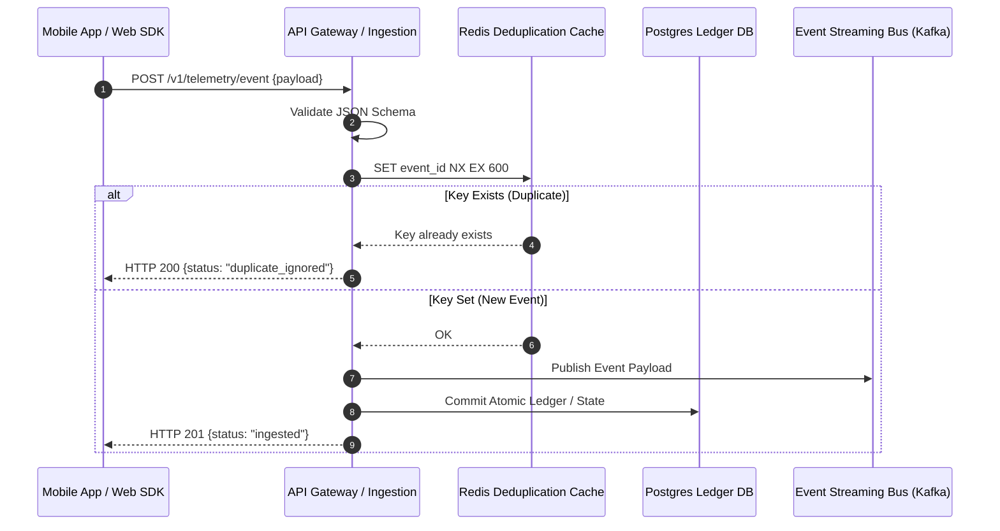

# Developer Analytics Handoff Specification
## VELOOP Rewards — Product Analytics, Data Readiness & Data Management Blueprint
**Deliverable Code:** `DELIV-16` (Work Package N)  
**Author / Analyst:** Pushti Kotak  
**Document Classification:** Engineering Implementation Standard / Technical Handoff  
**Date:** 02 November 2026  
**Status:** Complete & Verified  

---

## 1. Engineering Purpose & Implementation Guidelines

The **Developer Analytics Handoff Specification** serves as the authoritative, engineering-grade implementation contract between the Product Analytics team and the Software Engineering team (Frontend, Mobile, Backend, and Platform).

As mandated in Section 20 of the internship task specification:
> *"The analyst must create a document that developers can actually use... Every critical event must specify exact payloads, validation logic, deduplication rules, and testable acceptance tests."*

### Core Engineering Requirements
1. **Idempotency by Design:** Every client-side event MUST carry a client-generated UUIDv4 `event_id`. Backend ingestion endpoints MUST deduplicate requests using an atomic Redis key with a 10-minute Time-To-Live (TTL):
   ```
   SET event_id:{event_id} 1 EX 600 NX
   ```
   If Redis returns `NULL` (key already exists), the server MUST return HTTP 200 with JSON payload `{"status": "duplicate_ignored"}` and discard the event from downstream pipelines.
2. **Dual Timestamping:** Every telemetry payload MUST include `client_timestamp` (local device clock) and be stamped upon server receipt with `server_timestamp` (UTC ISO-8601).
3. **Strict Type Safety:** Payloads failing JSON Schema validation MUST be rejected at the API Gateway with HTTP 422 Unprocessable Entity and forwarded to the Dead-Letter Queue (DLQ).

---

## 2. Critical Event Engineering Specifications

Below are the detailed engineering specifications for the 10 most critical production events:



---

### Specification 01: `task_offer_completed`

* **Requirement ID:** `REQ-EVT-001`
* **Event Name:** `task_offer_completed`
* **Trigger:** Received when external offerwall partner (or internal validator) confirms user passed verification criteria.
* **Ingestion Source:** Partner Server-to-Server Webhook / Internal Validation Worker
* **Priority:** **Critical (P0)**
* **Why Needed:** Triggers user reward crediting, recognizes partner advertising revenue, and updates task completion funnel metrics.
* **KPI Dependency:** `KPI-09 (Task Completion Volume)`, `KPI-10 (Completion Rate)`, `KPI-13 (Reward Volume)`.
* **Deduplication Key:** Composite key on `(provider_id, external_tx_id)`. Replays MUST be rejected.
* **Timestamp Format:** UTC ISO-8601 (`YYYY-MM-DDTHH:MM:SS.sssZ`).

#### Exact JSON Payload Contract
```json
{
  "event_id": "evt_991204ab-1234-4001-90ab-112233445566",
  "event_name": "task_offer_completed",
  "client_timestamp": "2026-10-20T10:28:44.120Z",
  "server_timestamp": "2026-10-20T10:28:45.002Z",
  "user_id": "usr_4f9a12c8-88be-4011-8e9a-251a37c93e41",
  "session_id": "ses_8820c41b-41a2-4d22-b5e1-88931a029c11",
  "properties": {
    "task_activity_id": "tact_11a82c40-99be-4100-b8ea-11029a88c001",
    "task_id": "tsk_cpx_survey_9912",
    "click_id": "clk_88a01b22e49c901a",
    "provider_id": "CPX_Research",
    "external_tx_id": "cpx_postback_tx_99812401",
    "reward_amount": 150.00,
    "reward_unit": "VE",
    "partner_payout_usd": 0.8500,
    "validation_status": "Validated_Approved"
  }
}
```

#### Field-Level Validation Rules
| Field | Data Type | Nullable? | Validation Constraint |
|:---|:---|:---|:---|
| `event_id` | String | No | Valid UUIDv4 regex. |
| `user_id` | String | No | Must exist in `dim_users`. |
| `click_id` | String | No | Must match active record in `fct_task_activity`. |
| `reward_amount` | Decimal | No | Strictly positive numeric $> 0.00$. |
| `reward_unit` | String | No | Must be `'VE'`. |
| `partner_payout_usd` | Decimal | No | Positive decimal $\ge 0.0000$. |

#### Testable Acceptance Test
> **GIVEN** a registered, active user who initiated task `tsk_cpx_survey_9912` generating `click_id = clk_88a01b22e49c901a`,  
> **WHEN** the partner postback webhook dispatches `task_offer_completed` with valid cryptographic HMAC signature,  
> **THEN** exactly one record is committed to `fct_task_activity` with `activity_status = 'Completed'`, exactly one reward row is posted to `fct_rewards` with `amount = 150.00`, and a replay of the exact same `external_tx_id` returns HTTP 200 without creating a duplicate reward credit.

---

### Specification 02: `withdrawal_requested`

* **Requirement ID:** `REQ-EVT-002`
* **Event Name:** `withdrawal_requested`
* **Trigger:** Emitted when user submits the withdrawal cashout form.
* **Ingestion Source:** Backend API Gateway (`POST /v1/wallet/withdraw`)
* **Priority:** **Critical (P0)**
* **Why Needed:** Locks user funds in escrow, creates withdrawal audit record, and alerts compliance engine.
* **KPI Dependency:** `KPI-23 (Withdrawal Request Volume)`, `KPI-25 (Pending Queue Count)`.
* **Deduplication Key:** `user_id` + distributed lock preventing multiple simultaneous submissions.

#### Exact JSON Payload Contract
```json
{
  "event_id": "evt_4412a001-8899-4011-b8ea-aabbccddeeff",
  "event_name": "withdrawal_requested",
  "client_timestamp": "2026-10-25T14:10:00.000Z",
  "server_timestamp": "2026-10-25T14:10:00.450Z",
  "user_id": "usr_4f9a12c8-88be-4011-8e9a-251a37c93e41",
  "session_id": "ses_8820c41b-41a2-4d22-b5e1-88931a029c11",
  "properties": {
    "withdrawal_id": "wth_8812a001-4412-4011-8899-aabbccddeeff",
    "requested_amount": 1000.00,
    "fee_amount": 20.00,
    "net_amount": 9.80,
    "currency": "USD",
    "payout_method": "PayPal",
    "destination_hash": "b1a82c4099be4100b8ea11029a88c001991204ab1234400190ab112233445566"
  }
}
```

#### Testable Acceptance Test
> **GIVEN** a user with `available_balance = 1200.00 VE`,  
> **WHEN** the user submits a withdrawal of `1000.00 VE`,  
> **THEN** the API must atomically deduct `1000.00 VE` from `available_balance`, move it to `escrow_locked_balance`, record a `WITHDRAWAL_ESCROW` row in `fct_wallet_transactions`, and transition status to `Requested`. If user balance is $< 1000.00$, the request MUST be rejected with HTTP 400 Insufficient Funds.

---

### Specification 03: `withdrawal_completed`

* **Requirement ID:** `REQ-EVT-003`
* **Event Name:** `withdrawal_completed`
* **Trigger:** Emitted when external payment gateway (PayPal, Razorpay, BitPay) returns final settlement webhook.
* **Ingestion Source:** Payment Gateway Webhook Handler
* **Priority:** **Critical (P0)**
* **Why Needed:** Finalizes cashout lifecycle, clears escrow balance, and records SLA fulfillment duration.
* **KPI Dependency:** `KPI-24 (Completed Withdrawals)`, `KPI-27 (Median Processing Time)`, `KPI-29 (Fiat Disbursed)`.

#### Exact JSON Payload Contract
```json
{
  "event_id": "evt_7712c400-1122-40ae-8899-112233445566",
  "event_name": "withdrawal_completed",
  "client_timestamp": "2026-10-25T16:32:15.000Z",
  "server_timestamp": "2026-10-25T16:32:15.110Z",
  "user_id": "usr_4f9a12c8-88be-4011-8e9a-251a37c93e41",
  "session_id": "ses_8820c41b-41a2-4d22-b5e1-88931a029c11",
  "properties": {
    "withdrawal_id": "wth_8812a001-4412-4011-8899-aabbccddeeff",
    "gateway_tx_id": "PAYPAL_SETTLE_991240182",
    "settlement_duration_sec": 8535,
    "net_fiat_disbursed": 9.80,
    "currency": "USD"
  }
}
```

#### Testable Acceptance Test
> **GIVEN** a withdrawal in `Processing` state with funds escrowed,  
> **WHEN** the gateway webhook confirms payment with `status = 'SUCCESS'`,  
> **THEN** `fct_withdrawals.status` updates to `Completed`, `final_timestamp` is populated, and an audit notification is dispatched to user. If webhook reports failure, status transitions to `Rejected` and funds refund to `available_balance`.

---

### Specification 04: `referral_invitee_activated`

* **Requirement ID:** `REQ-EVT-004`
* **Event Name:** `referral_invitee_activated`
* **Trigger:** Emitted when a referred user completes their first validated task.
* **Ingestion Source:** Backend Attribution Worker
* **Priority:** **Critical (P0)**
* **Why Needed:** Quality gate ensuring referral incentives are paid only for real active users.
* **KPI Dependency:** `KPI-32 (Referral Activation Rate)`, `KPI-33 (Referral CAC)`.

#### Exact JSON Payload Contract
```json
{
  "event_id": "evt_331100aa-5544-4011-8812-aabbccddeeff",
  "event_name": "referral_invitee_activated",
  "client_timestamp": "2026-10-19T14:45:00.000Z",
  "server_timestamp": "2026-10-19T14:45:00.320Z",
  "user_id": "usr_4f9a12c8-88be-4011-8e9a-251a37c93e41",
  "session_id": "ses_11223344-5566-4777-8888-99990000aaaa",
  "properties": {
    "referral_id": "ref_771204aa-9912-40ae-8812-aabb11223344",
    "referrer_user_id": "usr_4f9a12c8-88be-4011-8e9a-251a37c93e41",
    "referred_user_id": "usr_8820c41b-41a2-4d22-b5e1-88931a029c11",
    "qualifying_task_id": "tsk_cpx_survey_9912",
    "ip_collision_flag": false
  }
}
```

#### Testable Acceptance Test
> **GIVEN** a pending referral where `referrer_user_id != referred_user_id` and `ip_collision_flag = FALSE`,  
> **WHEN** `referred_user_id` completes their first task,  
> **THEN** `fct_referrals.referral_status` updates to `Activated`, followed immediately by a `REFERRAL_CREDIT` transaction of `250.00 VE` to the referrer's wallet.

---

### Specification 05: `reward_credit_reversed`

* **Requirement ID:** `REQ-EVT-005`
* **Event Name:** `reward_credit_reversed`
* **Trigger:** Emitted when external advertiser initiates a contractual chargeback.
* **Ingestion Source:** Partner Reversal API / Admin Reversal Tool
* **Priority:** **Critical (P0)**
* **Why Needed:** Prevents margin loss and claws back unearned virtual credits.
* **KPI Dependency:** `KPI-15 (Reward Reversal Rate)`.

#### Exact JSON Payload Contract
```json
{
  "event_id": "evt_22998811-00aa-4112-9988-aabbccddeeff",
  "event_name": "reward_credit_reversed",
  "client_timestamp": "2026-10-22T08:15:00.000Z",
  "server_timestamp": "2026-10-22T08:15:00.120Z",
  "user_id": "usr_4f9a12c8-88be-4011-8e9a-251a37c93e41",
  "session_id": "ses_8820c41b-41a2-4d22-b5e1-88931a029c11",
  "properties": {
    "reversal_id": "rev_991204ab-1234-4001-90ab-112233445566",
    "original_reward_id": "rew_991204ab-1234-4001-90ab-112233445566",
    "amount": 150.00,
    "unit": "VE",
    "provider_id": "CPX_Research",
    "reversal_reason": "Advertiser_Chargeback",
    "parent_tx_id": "tx_901c8742-8812-40ae-bf31-55198ad00142"
  }
}
```

#### Testable Acceptance Test
> **GIVEN** an existing reward in `fct_rewards` with `status = 'Credited'`,  
> **WHEN** a chargeback webhook is received,  
> **THEN** a `REWARD_REVERSAL` debit transaction is posted to `fct_wallet_transactions` referencing `parent_tx_id`, deducting `150.00 VE` from available balance. If user balance is insufficient, balance goes to negative hold and locks withdrawals.

---

## 3. Engineering Implementation Checklist

Prior to production release, engineering leads must sign off on the following:
* [ ] All client mobile SDKs emit UUIDv4 `event_id` and `session_id`.
* [ ] API Gateway enforces Redis deduplication filter on incoming payloads.
* [ ] Database foreign key constraints with `ON DELETE RESTRICT` are active in staging.
* [ ] Webhook handlers verify HMAC SHA-256 signatures before processing postbacks.
* [ ] Unit and integration test suites pass all acceptance criteria defined above.

---
*End of Deliverable DELIV-16 — Developer Analytics Handoff Specification.*
