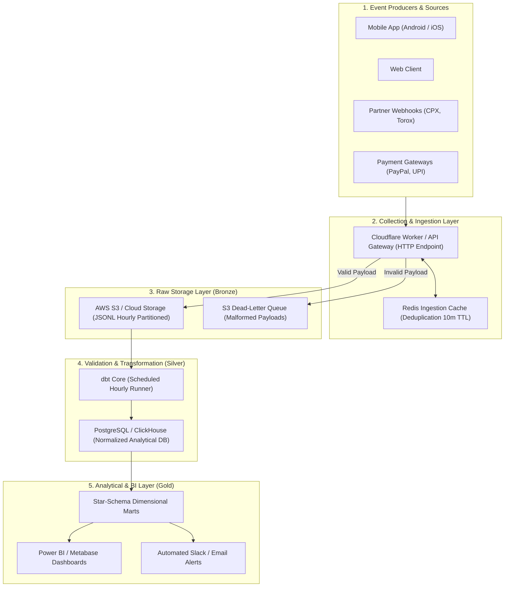
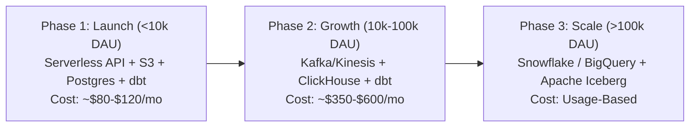

# Data Pipeline Proposal & Operating Model
## VELOOP Rewards — Product Analytics, Data Readiness & Data Management Blueprint
**Deliverable Code:** `DELIV-17` (Work Package O)  
**Author / Analyst:** Pushti Kotak  
**Document Classification:** Internal Technical Architecture / Data Engineering Operating Model  
**Date:** 02 November 2026  
**Status:** Complete & Verified  

---

## 1. Architectural Philosophy: Pragmatic & Cost-Effective

As strictly mandated in Section 21 of the VELOOP Internship Task Specification:  
> *"Do not recommend expensive infrastructure merely because it sounds professional. The architecture must be practical for a developing product and scalable when justified."*

Many early-stage startups make the disastrous mistake of prematurely deploying multi-thousand-dollar enterprise platforms (e.g., Kafka clusters, Databricks, Snowflake Enterprise editions) before they have validated product-market fit or consistent event volumes. 

VELOOP’s data pipeline is engineered around a **lean, reliable micro-batch ELT (Extract, Load, Transform)** pattern using cost-effective serverless and managed components. The total infrastructure cost is estimated at under **$120/month at launch**, scaling smoothly as user acquisition grows.

---

## 2. End-to-End Data Pipeline Flow



---

## 3. Layer-by-Layer Technical Architecture

### 1. Source Systems & Event Producers
* **Mobile & Web SDKs:** Lightweight telemetry library embedded in the React Native / Android client emitting JSON payloads for user actions (`task_offer_started`, `daily_reward_claimed`).
* **Partner Postback Webhooks:** External HTTP callbacks from CPX Research, Torox, and BitLabs informing VELOOP of survey and game conversions.
* **Payment Gateway Callbacks:** Webhooks from payment processors (PayPal, Razorpay, BitPay) confirming cashout settlements.

### 2. Collection & Ingestion Layer
* **Technology:** Cloudflare Workers or AWS API Gateway backed by AWS Lambda (Serverless).
* **Cost:** Free tier to $\approx \$5/\text{month}$.
* **Function:** Validates incoming payload JSON schemas, verifies partner HMAC signatures, performs deduplication against Redis cache (`event_id`), and appends `server_timestamp`.

### 3. Raw Data Storage Layer (Bronze Lake)
* **Technology:** AWS S3 Standard-IA or Google Cloud Storage.
* **Cost:** $\approx \$5–\$10/\text{month}$ for 50GB storage.
* **Format:** Compressed JSON Lines (`.jsonl.gz`), partitioned chronologically by domain and hour:
  ```
  s3://veloop-telemetry-raw/events/year=2026/month=10/day=20/hour=14/events_part_001.jsonl.gz
  ```
* **Benefit:** Immutable, permanent audit trail. Any future schema bug or historical restatement can be replayed from raw files.

### 4. Transformation & Quality Layer (Silver Warehouse)
* **Technology:** `dbt Core` (open-source) executing on a managed PostgreSQL 16 database (or single-node ClickHouse instance as event volume exceeds 10M rows/month).
* **Cost:** $\approx \$35–\$60/\text{month}$ for managed cloud RDS instance.
* **Operation:** Hourly micro-batch jobs parsing raw JSON into strongly-typed relational tables (`dim_users`, `fct_task_activity`, `fct_wallet_transactions`).
* **Automated Data Quality:** Embedded dbt tests enforcing:
  * Primary key uniqueness (`unique`)
  * Non-null constraints on mandatory columns (`not_null`)
  * Referential integrity (`relationships`)
  * Accepted enumerations (`accepted_values`)

### 5. Analytical Marts & Reporting Layer (Gold)
* **Technology:** Optimized analytical views (`dim_users`, `fct_daily_kpis`) queried directly by Power BI Desktop / Metabase.
* **Cost:** Free (Metabase Open-Source or Power BI Desktop).
* **Cadence:** Executive Overview and Cashout queues refresh hourly; deep cohort retention and KPI catalogues refresh daily at 01:00 UTC.

---

## 4. Pipeline Operating Model, Monitoring & Failure Handling

| Component | Operational Task | Cadence | Failure Scenario | Automated Recovery / Runbook | Responsible Team |
|:---|:---|:---|:---|:---|:---|
| **API Ingestion** | Schema Validation & Webhook Reception | Continuous (24/7) | Ingestion endpoint returns HTTP 500/504 errors. | API Gateway auto-scales; unhandled payloads route to Dead-Letter Queue (DLQ). PagerDuty alert fires. | DevOps / On-Call |
| **Redis Cache** | Event Deduplication | Continuous (24/7) | Redis instance restarts or runs out of memory. | Fail-open design: gateway continues ingestion, relying on downstream SQL `ROW_NUMBER()` deduplication. | Platform Eng |
| **S3 Raw Storage** | Object Archival | Continuous | AWS S3 write permission failure. | Cloudflare Worker buffers events locally for 60 seconds and retries. | Infrastructure |
| **dbt Transformation** | Bronze-to-Silver Relational ELT | Hourly (:15 past hour) | dbt test failure (e.g., orphan records or null PK). | Staging table load completes, but alert sent to `#data-alerts`. Errant rows quarantined; pipeline does not crash. | Analytics Eng |
| **Ledger Reconciliation**| Mathematical Balance Audit | Daily (00:30 UTC) | `SUM(credits) - SUM(debits) != balance` detected. | P0 Critical Alert. Immediate auto-pause on automated withdrawal dispatch queue. Lead Architect paged. | Data Architect / DBA |
| **Dashboard BI** | Power BI Semantic Model Refresh | Daily (02:00 UTC) | Gateway timeout during scheduled semantic refresh. | Auto-retry twice; if failed, dashboard surfaces "Stale Data" banner and emails BI specialist. | BI Specialist |

---

## 5. Scaling Strategy & Evolution Path



1. **Launch Phase (Current Blueprint):** Managed PostgreSQL + dbt Core + Serverless Ingestion. Handles up to 25 million events per month with sub-second query performance on indexed tables.
2. **Growth Phase (Trigger: $> 10,000$ DAU or $> 1\text{M}$ events/day):** Migrate analytical fact tables to ClickHouse for columnar compression, maintaining Postgres as the transactional ledger.
3. **Mature Enterprise Scale (Trigger: Multi-country expansion $> 100,000$ DAU):** Adopt modern cloud lakehouse (BigQuery or Snowflake) with dbt Cloud and streaming ingestion.

---
*End of Deliverable DELIV-17 — Data Pipeline Proposal & Operating Model.*
