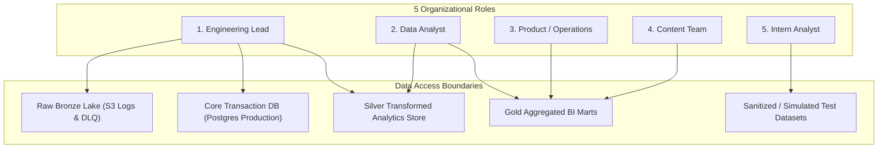

# Data Access, Privacy & Governance Policy
## VELOOP Rewards — Product Analytics, Data Readiness & Data Management Blueprint
**Deliverable Code:** `DELIV-18` (Work Package P)  
**Author / Analyst:** Pushti Kotak  
**Document Classification:** Internal Compliance Standard / Data Governance Policy  
**Date:** 02 November 2026  
**Status:** Complete & Verified  

---

## 1. Governance Objectives & Compliance Standard

The **Data Access, Privacy & Governance Policy** establishes the administrative, legal, and cryptographic controls governing data protection across VELOOP Rewards. 

As mandated in Section 22 and Section 34 of the internship task specification:
> *"The analyst must design a basic access model across 5 organizational roles and explicitly identify information that should NOT be unnecessarily exposed... Never request passwords, API keys, payment credentials, or unnecessary personal-data fields."*

This framework ensures compliance with the **Digital Personal Data Protection (DPDP) Act 2023** and **General Data Protection Regulation (GDPR)** by embedding the principles of **Data Minimization**, **Purpose Limitation**, and **Storage Limitation** directly into the relational schema and analytical access layers.

---

## 2. Sensitive Information Blacklist (Strict Exclusion from Analytics)

The following data categories are classified as **Forbidden Telemetry**. They must be blocked at the API Gateway or permanently encrypted in dedicated credential vaults. **Under no circumstances may these attributes be logged into telemetry streams, stored in raw S3 buckets, or exposed in analytical reporting tables:**

```
+-----------------------------------------------------------------------------------------------+
| SENSITIVE INFORMATION BLACKLIST: ZERO EXPOSURE IN ANALYTICS PIPELINES                         |
+-----------------------------------------------------------------------------------------------+
| 1. Passwords & Hashes:       Raw plaintext passwords, bcrypt hashes, salts, reset tokens.   |
| 2. Authentication Secrets:   OAuth access tokens, refresh tokens, session JWT private keys.  |
| 3. API & Partner Credentials: Partner webhook HMAC secret keys, advertiser API bearer tokens. |
| 4. Financial Credentials:    Raw credit card numbers, CVVs, bank account numbers, UPI PINs.  |
| 5. Government Identifiers:   Aadhaar numbers, SSNs, passport numbers, driver's licenses.     |
| 6. Precision Geolocation:    Raw high-precision GPS latitude/longitude coordinates (<100m).   |
+-----------------------------------------------------------------------------------------------+
```

### Pseudonymization & Masking Standards
* **User Identifiers:** Analytics models use the canonical surrogate `user_id` (`usr_...`). Personal email addresses are never joined into fact tables.
* **IP Addresses:** Raw IP addresses are hashed using SHA-256 with a daily rotating salt (`ip_hash = SHA256(ip + salt)`) for sybil fraud detection, then converted to coarse ISO country/region codes (`country_code = 'IN'`). The raw IP is purged immediately after ingestion.
* **Payment Destination Handles:** User payout addresses (PayPal email, UPI ID, crypto wallet) are masked in analytical tables: `destination_hash = SHA256(handle)`. Customer support agents access raw payment handles strictly through a separate, access-logged operational portal requiring multi-factor authentication (MFA).

---

## 3. Role-Based Access Control (RBAC) Matrix

To enforce least-privilege security across the organization, data access is partitioned across **five distinct organizational roles**:



| Operating Layer / Data Asset | 1. Engineering | 2. Data Analyst | 3. Product / Operations | 4. Content Team | 5. Intern Analyst |
|:---|:---:|:---:|:---:|:---:|:---:|
| **Production Auth & Password Vault** | **Restricted Read** (Admin) | **NO ACCESS** | **NO ACCESS** | **NO ACCESS** | **NO ACCESS** |
| **Raw S3 Telemetry Logs (Bronze)** | **Full Read / Write** | **Read-Only** | **NO ACCESS** | **NO ACCESS** | **NO ACCESS** |
| **Core Relational DB (Production)** | **Full Admin / DDL** | **Read-Only Replica** | **NO ACCESS** | **NO ACCESS** | **NO ACCESS** |
| **Silver Analytical Tables (`dim_users`, `fct_*`)** | **Full Access** | **Full Analytical Read**| **Restricted Read** (No PII) | **NO ACCESS** | **NO ACCESS** |
| **Gold Aggregated BI Marts (Power BI)** | **Full Access** | **Full Modeling Access**| **Dashboard Read-Only**| **Filtered Read** (Content Only)| **NO ACCESS** |
| **Sanitized / Simulated Datasets** | **Full Access** | **Full Access** | **Full Access** | **Full Access** | **Full Access** |
| **Masked PII (`destination_hash`, `signup_ip_hash`)**| **Read-Only** (Security) | **Hashed Read-Only** | **NO ACCESS** | **NO ACCESS** | **NO ACCESS** |

---

## 4. Privacy-by-Design Compliance Standard

### 1. Right to Erasure / Account Deletion (GDPR Art. 17 & DPDP Sec. 12)
When a user requests account deletion:
1. The user's row in the primary Authentication Database is hard-deleted or anonymized.
2. In the analytical warehouse, `dim_users` updates `account_status = 'Deleted'` and scrubs all demographic attributes (`signup_device_type = 'REDACTED'`, `signup_ip_hash = 'PURGED'`).
3. Historical transactional fact rows (`fct_wallet_transactions`, `fct_withdrawals`) **retain the synthetic `user_id`**. This ensures financial ledger reconciliations and tax accounting remain mathematically balanced without holding personal identifiers.

### 2. Purpose Limitation & Data Retention
* **Raw Clickstream Telemetry (`fct_feature_events`):** Retained in hot storage for **90 days**, transitioning to compressed cold S3 Glacier storage for **12 months**, after which it is automatically purged via S3 lifecycle rules.
* **Financial Ledger & Cashouts (`fct_wallet_transactions`, `fct_withdrawals`):** Retained for **7 years** in compliance with statutory financial auditing and anti-money laundering (AML) regulations.

---
*End of Deliverable DELIV-18 — Data Access, Privacy & Governance Policy.*
