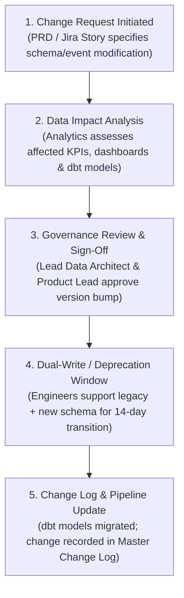

# Analytics Change Management Framework
## VELOOP Rewards — Product Analytics, Data Readiness & Data Management Blueprint
**Deliverable Code:** `DELIV-19` (Work Package Q)  
**Author / Analyst:** Pushti Kotak  
**Document Classification:** Internal Technical Governance / Change Management Standard  
**Date:** 02 November 2026  
**Status:** Complete & Verified  

---

## 1. Architectural Purpose & Problem Statement

As established in Section 23 of the VELOOP Internship Task Specification:  
> *"VELOP will evolve. Therefore, the analyst must propose how analytics should change when a feature changes, an event changes, a reward mechanic changes, a withdrawal method changes, a field is renamed, a KPI definition changes, or a dashboard changes."*

In fast-moving product teams, unannounced schema modifications (e.g., an engineer renaming an event property or changing an enum string) silently break downstream data pipelines, invalidate historical dashboard comparisons, and corrupt core executive KPIs.

This framework establishes:
1. **The Analytics Change Protocol** governing technical schema evolutions and metric redefinitions.
2. **Backward-Compatibility & Versioning Standards**.
3. **The Master Metric & Event Change Log** tracking all historical modifications, impacted assets, and responsible owners.

---

## 2. The 5-Step Analytics Change Protocol

Whenever a product change impacts data structures, the following lifecycle is mandatory prior to deploying code to production:

1. **Change Request Initiation:** The developer or product manager files an Analytics Impact Ticket linking the Jira feature issue.
2. **Impact Assessment:** The Data Analyst identifies all affected downstream entities:
   * Event Tracking Plan (`DELIV-08`)
   * Data Dictionary (`DELIV-09`)
   * Affected KPIs in Catalogue (`DELIV-11`)
   * Power BI Semantic Models & Dashboards (`DELIV-15`)
3. **Semantic Versioning Standard:**
   * **PATCH (v1.0.1):** Adding an optional property to an event payload; non-breaking.
   * **MINOR (v1.1.0):** Introducing a new event or non-mandatory table column; backward compatible.
   * **MAJOR (v2.0.0):** Renaming an event, removing a required field, or altering a KPI mathematical formula; requires dual-write deprecation.
4. **Dual-Write Transition Window:** For breaking changes, backend and client SDKs must emit both the legacy event and the new event for a minimum **14-day migration window** before the legacy event is retired.
5. **Formal Documentation:** The change is published to the Master Metric & Event Change Log.

---

## 3. Master Metric & Event Change Log

The register below documents the formal change log for VELOOP Rewards, establishing clear operational lineage and impact analysis:

| Change ID | Release Date | Change Type | Old Definition / Schema | New Definition / Schema | Causal Reason & Business Justification | Affected KPIs | Affected Dashboards | Affected Reports / Models | Change Owner | Version |
|:---|:---|:---|:---|:---|:---|:---|:---|:---|:---|:---:|
| **CHG-001** | 2026-09-15 | **Event Addition** | None (No tracking) | Added event: `onboarding_flow_completed` | Needed to measure initial user drop-off during onboarding tutorial. | NUR, Onboarding Rate | Dashboard 2 (User) | `dim_users`, `fct_feature_events` | Mobile Client Lead | `v1.1.0` |
| **CHG-002** | 2026-10-01 | **Ledger Refactor** | Single scalar balance in user table (`user_balance INT`) | Multi-bucket ledger: `available_balance`, `pending_balance`, `escrow_balance` | Prevented users from cashing out unverified partner rewards prior to verification. | Net Liability, Discrepancy Rate | Dashboard 1, Dashboard 5 | `fct_wallet_transactions` | Lead Data Architect | `v2.0.0` |
| **CHG-003** | 2026-10-12 | **Event Rename** | Legacy: `task_completed` | Canonical: `task_offer_completed` | Standardized naming under `domain_object_action` hierarchy across platforms. | Task Completion Rate | Dashboard 1, Dashboard 3 | `fct_task_activity` | Analytics Eng | `v2.0.0` |
| **CHG-004** | 2026-10-18 | **New Payout Rail**| Payout methods limited to PayPal & Gift Cards | Added: `UPI_Direct` for Indian domestic transfers | Supported local payout rails for high-growth Indian user demographic. | Payout Mix, Median Settlement Time | Dashboard 6 (Withdrawals) | `fct_withdrawals` | Payments Eng | `v1.2.0` |
| **CHG-005** | 2026-10-25 | **KPI Formula Refinement** | Referral Conversion = `COUNT(Registrations)` | Referral Conversion = `COUNT(Invitee Activated Tasks >= 1)` | Eliminated bot-registration rings that drained referral budget without active users. | Referral CAC, Conversion Rate | Dashboard 7 (Referrals) | `fct_referrals` | Growth Lead | `v2.1.0` |
| **CHG-006** | 2026-11-01 | **Security Masking**| Stored raw PayPal email and UPI handle in withdrawal table | Stored `destination_hash` (SHA-256) in analytics; raw in Vault | Upholds GDPR and DPDP compliance; eliminated PII from BI query layer. | None (Schema Security) | None (Backend Security) | `fct_withdrawals` | Security Lead | `v2.2.0` |

---

## 4. Engineering Deprecation & Rollback Runbook

1. **Breaking Change Deprecation Notice:** Engineering must broadcast deprecation notices in `#eng-announcements` at least 7 days prior to sprint deployment.
2. **Rollback Procedure:** If a deployed schema change results in unparseable events hitting the Dead-Letter Queue (DLQ rate $> 2.0\%$), the API Gateway configuration is immediately rolled back via Canary deployment, restoring the previous schema definition.
3. **Historical Data Reconciliation:** When a KPI formula changes (as in `CHG-005`), historical reporting tables must retain a `metric_version` column to ensure analysts can reproduce historical board reports without discrepancies.

---
*End of Deliverable DELIV-19 — Analytics Change Management Framework.*
