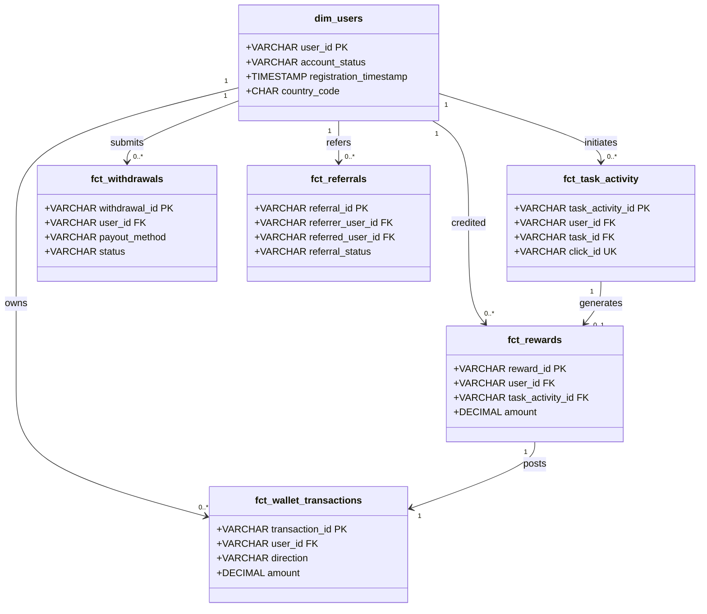

# Logical Data Model & Relational Schema Architecture
## VELOOP Rewards — Product Analytics, Data Readiness & Data Management Blueprint
**Deliverable Code:** `DELIV-10` (Work Package H)  
**Author / Analyst:** Pushti Kotak  
**Document Classification:** Internal Technical Architecture / Database Engineering Standard  
**Date:** 02 November 2026  
**Companion Artifacts:**  
- Visual ER Diagram: [`logical_data_model.mermaid`](logical_data_model.mermaid)  
- Production DDL Script: [`schema_ddl.sql`](schema_ddl.sql)  
**Status:** Complete & Verified  

---

## 1. Architectural Principles & Normalization Standard

The **VELOP Logical Data Model** is engineered to serve as both an operational transaction store and an analytical reporting foundation. In strict compliance with Section 14 (H1–H4) of the task specification, this model enforces:
1. **Third Normal Form (3NF) Operational Integrity:** Prevents insertion, update, and deletion anomalies across transactional entities (`dim_users`, `dim_tasks`, `fct_task_activity`, `fct_wallet_transactions`, `fct_withdrawals`).
2. **Double-Entry Financial Ledger:** No balance exists as an unverified mutable scalar. Every user balance is reconstructible as the net mathematical sum of debit and credit mutations in `fct_wallet_transactions`.
3. **Idempotency & Replay Protection:** Enforces surrogate UUIDv4 primary keys and unique tracking constraints (`click_id`, `event_id`, `external_tx_id`) to ensure safe data recovery during mobile network retries and partner postback replays.
4. **Privacy-by-Design:** Decouples analytical user identities from raw personal credentials. Personal data (IP addresses, payment handles) is pseudonymized or masked with cryptographic SHA-256 digests prior to persistence.

---

## 2. H1 & H2. Entity Inventory, Primary Keys & Foreign Key Mapping

The schema comprises **11 distinct relational entities** organized into Dimensions, Facts, and Association Tables:

| Entity Name | Entity Classification | Primary Key (PK) | Foreign Keys (FK) & Parent References | Cardinality & Parent Linkage |
|:---|:---|:---|:---|:---|
| `dim_users` | Core Dimension | `user_id` (UUID) | None | Root user entity across entire ecosystem. |
| `dim_tasks` | Catalog Dimension | `task_id` (VARCHAR) | None | Root catalog for earning opportunities and campaigns. |
| `fct_task_activity` | Core Transactional Fact | `task_activity_id` (UUID) | `user_id` $\rightarrow$ `dim_users` `task_id` $\rightarrow$ `dim_tasks` | $N:1$ to `dim_users` $N:1$ to `dim_tasks` |
| `fct_rewards` | Financial Fact | `reward_id` (UUID) | `user_id` $\rightarrow$ `dim_users` `task_activity_id` $\rightarrow$ `fct_task_activity` | $N:1$ to `dim_users` $1:1$ (optional) to `fct_task_activity` |
| `fct_wallet_transactions` | Double-Entry Ledger Fact | `transaction_id` (UUID) | `user_id` $\rightarrow$ `dim_users` `parent_tx_id` $\rightarrow$ `fct_wallet_transactions` | $N:1$ to `dim_users` $1:1$ recursive for reversals |
| `fct_withdrawals` | Cashout Fact | `withdrawal_id` (UUID) | `user_id` $\rightarrow$ `dim_users` | $N:1$ to `dim_users` |
| `fct_referrals` | Viral Attribution Fact | `referral_id` (UUID) | `referrer_user_id` $\rightarrow$ `dim_users` `referred_user_id` $\rightarrow$ `dim_users` | $N:1$ to `dim_users` (referrer) $1:1$ to `dim_users` (referred) |
| `fct_feature_events` | Behavioral Telemetry Fact | `event_id` (UUID) | `user_id` $\rightarrow$ `dim_users` | $N:1$ to `dim_users` |
| `dim_badges_missions` | Gamification Dimension | `item_id` (VARCHAR) | None | Master catalog of badges, quests, and trophies. |
| `map_user_badges` | Associative Mapping (M:N) | `map_id` (UUID) | `user_id` $\rightarrow$ `dim_users` `item_id` $\rightarrow$ `dim_badges_missions` | $N:1$ to `dim_users` $N:1$ to `dim_badges_missions` |
| `fct_support_tickets` | Operational Dispute Fact | `ticket_id` (UUID) | `user_id` $\rightarrow$ `dim_users` `task_id` $\rightarrow$ `dim_tasks` | $N:1$ to `dim_users` $N:1$ (optional) to `dim_tasks` |

---

## 3. H3. Relationship Documentation & Cardinality Rules

### Detailed Cardinality Explanations

1. **`dim_users` to `fct_task_activity` ($1:N$ — One-to-Many):**
   * *Relationship:* A single registered user can initiate zero, one, or thousands of earning tasks over their customer lifetime.
   * *Referential Rule:* A task activity attempt must always resolve to an existing `user_id`. `ON DELETE RESTRICT` prevents accidental deletion of user accounts with active task histories.

2. **`dim_tasks` to `fct_task_activity` ($1:N$ — One-to-Many):**
   * *Relationship:* A single campaign/offer in the catalog can be attempted by many different users simultaneously.
   * *Referential Rule:* `task_id` must match a registered campaign.

3. **`fct_task_activity` to `fct_rewards` ($1:0..1$ — One-to-Zero-or-One):**
   * *Relationship:* A completed task activity generates at most one reward credit. Failed or abandoned attempts generate zero rewards.
   * *Referential Rule:* Unique constraint on `task_activity_id` within `fct_rewards` prevents duplicate reward payouts for the same execution attempt.

4. **`fct_rewards` to `fct_wallet_transactions` ($1:1$ — One-to-One):**
   * *Relationship:* Every settled reward mutation corresponds to exactly one atomic credit entry in the double-entry transaction ledger.
   * *Integrity Rule:* `reference_id` in `fct_wallet_transactions` links directly to `reward_id`.

5. **`dim_users` to `fct_withdrawals` ($1:N$ — One-to-Many):**
   * *Relationship:* A user may submit multiple withdrawal requests over time as they accumulate withdrawable earnings.
   * *State Constraint:* A user cannot initiate a new cashout if they have insufficient settled balance. The amount is escrowed via a ledger debit at the exact timestamp of request.

6. **`dim_users` to `fct_referrals` ($1:N$ Dual Foreign Key):**
   * *Relationship:* `dim_users` participates in referrals in two distinct roles:
     * As `referrer_user_id` ($1:N$): A power user can invite many new users.
     * As `referred_user_id` ($1:0..1$): A newly registered invitee can be referred by at most one referrer.
   * *Integrity Rule:* Enforces `chk_ref_distinct_users` (`referrer_user_id != referred_user_id`) to block self-referral attempts.

7. **`dim_users` and `dim_badges_missions` via `map_user_badges` ($M:N$ — Many-to-Many):**
   * *Relationship:* A user can earn many distinct badges and missions; a badge or mission challenge can be unlocked by many users.
   * *Implementation:* Resolved via the associative junction table `map_user_badges`, with a composite unique constraint on `(user_id, item_id)`.

---

## 4. H4. Engineering Implementation & Indexing Strategy

To guarantee millisecond query performance on analytical aggregations and dashboard queries, the accompanying DDL script (`schema_ddl.sql`) incorporates targeted B-tree indexes:

1. **Temporal & Funnel Indexing:**
   * `idx_task_act_user_time` on `fct_task_activity(user_id, start_time)` accelerates user task history and conversion latency calculations.
   * `idx_wallet_tx_user` on `fct_wallet_transactions(user_id, timestamp)` allows rapid balance reconstruction and transaction statements.
2. **Operational SLA & Queue Indexing:**
   * `idx_withdrawals_status` on `fct_withdrawals(status, requested_timestamp)` powers real-time operations dashboards monitoring the pending cashout queue age.
3. **Telemetry Partitioning Recommendation (Post-Launch Scale):**
   * When `fct_feature_events` scales beyond 10 million rows, table partitioning by month (`PARTITION BY RANGE (server_timestamp)`) should be implemented to prevent index degradation.

---
*End of Deliverable DELIV-10 — Logical Data Model Architecture.*
